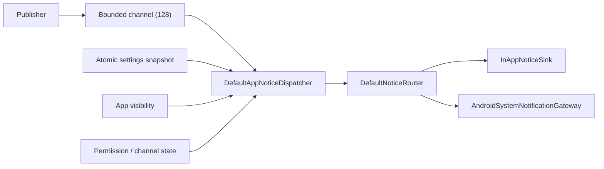

# 消息中心

## 边界与数据流

业务代码只发布 `AppNotice(eventId, code, arguments)`。`topic`、`level`、投递策略、强制性与
eventId TTL 由可信 `NoticeCodeRegistry` 决定，发布者不能伪造。参数只能使用 `Count`、
`DurationMs`、`EnumCode`、`ReasonCode` 或 `Flag`，不得传入自由文本、凭据、路径或 URL。

`publish()` 只返回入队结果；需要确定投递结果的调用方使用 `dispatch()` 获得
`NoticeDispatchReceipt`。Dispatcher 串行处理消息并在一次处理开始时原子读取设置版本，整条消息使用同一快照。

## 判定顺序

1. 以 `eventId` 获取两阶段去重 claim；同一事件正在处理或仍在 TTL 内时拒绝。
2. 读取 `NoticeCodePolicy`。非 mandatory 消息依次检查总开关、topic 开关和最低等级。
3. 根据 `DeliveryPolicy` 与前后台状态生成初始目标。
4. 系统目标同时检查产品设置、`POST_NOTIFICATIONS`、系统通知总开关和 channel。
5. `PREFER_*` 在首选目标不可用或投递失败时按策略回退；`SYSTEM_ONLY` 不回退。
6. 投递完成后，至少一个目标成功才完成 eventId claim；所有目标失败时释放 claim，允许同一事件重试。

强制消息只绕过产品总开关、topic 和最低等级，不绕过 Android 权限或系统 channel。

## 事件注册表

事件编号使用 `NoticeCode` 枚举名这一稳定字符串，不使用或持久化 Kotlin ordinal；枚举调整顺序不会改变事件编号。
所有事件的精确 `eventId` TTL 当前为 120 秒。同一 `NoticeCode` 的不同 `eventId` 始终分别投递，避免吞掉合法的连续操作。

| NoticeCode | Topic | Level | Delivery | Mandatory |
|---|---|---|---|---:|
| `CLIPBOARD_CLEARED` | CLIPBOARD | INFO | IN_APP_ONLY | 否 |
| `CLIPBOARD_CLEAR_FAILED` | CLIPBOARD | ERROR | IN_APP_ONLY | 否 |
| `APP_LOCKED` | APP_LIFECYCLE | INFO | IN_APP_ONLY | 否 |
| `APP_CLOSE_REMINDER` | APP_LIFECYCLE | WARNING | IN_APP_ONLY | 否 |
| `BACKUP_EXPORT_COMPLETED` | BACKUP | SUCCESS | PREFER_IN_APP | 否 |
| `BACKUP_EXPORT_FAILED` | BACKUP | ERROR | PREFER_IN_APP | 否 |
| `BACKUP_IMPORT_COMPLETED` | BACKUP | SUCCESS | PREFER_IN_APP | 否 |
| `BACKUP_IMPORT_FAILED` | BACKUP | ERROR | PREFER_IN_APP | 否 |
| `BACKUP_DIRECTORY_CHECK_COMPLETED` | BACKUP | SUCCESS | IN_APP_ONLY | 否 |
| `BACKUP_DIRECTORY_CHECK_FAILED` | BACKUP | ERROR | IN_APP_ONLY | 否 |
| `SECURITY_RECOVERY_REQUIRED` | SECURITY | CRITICAL | PREFER_IN_APP | 是 |
| `SECURITY_ACTION_FAILED` | SECURITY | ERROR | PREFER_SYSTEM | 是 |
| `DATABASE_INDEX_REBUILD_COMPLETED` | DATABASE | SUCCESS | PREFER_IN_APP | 否 |
| `DATABASE_INDEX_REBUILD_FAILED` | DATABASE | ERROR | PREFER_IN_APP | 否 |
| `DATABASE_OPERATION_FAILED` | DATABASE | ERROR | PREFER_IN_APP | 是 |
| `NOTIFICATION_PERMISSION_DENIED` | APP_LIFECYCLE | WARNING | IN_APP_ONLY | 否 |

应用内队列容量为 64；队列满时明确返回失败，不丢弃已排队消息。Dispatcher 仅在至少一个输出目标成功后保留 eventId claim，
全部失败会释放 claim 以支持重试。新增事件必须同时增加：枚举、注册策略、受控文本资源与解析映射、参数契约、Router/Dispatcher 测试以及本表。
不得增加 `StubSystemNotificationGateway` 或在 feature 中直接调用 `NotificationManager`。

## 代码位置

| 职责 | 类/函数 | 源码文件 |
| --- | --- | --- |
| 消息模型及受控参数 | `AppNotice`、`ArgumentKey`、`ArgumentValue` | [`AppNotice.kt`](../../app/src/main/java/com/aozijx/passly/app/message/model/AppNotice.kt)、[`NoticeArgument.kt`](../../app/src/main/java/com/aozijx/passly/app/message/model/NoticeArgument.kt) |
| 事件策略注册 | `NoticeCodeRegistry.policyFor()` | [`NoticeCodeRegistry.kt`](../../app/src/main/java/com/aozijx/passly/app/message/contract/NoticeCodeRegistry.kt) |
| 路由与分发 | `DefaultNoticeRouter.route()`、`DefaultAppNoticeDispatcher.dispatch()` | [`DefaultNoticeRouter.kt`](../../app/src/main/java/com/aozijx/passly/app/message/runtime/DefaultNoticeRouter.kt)、[`DefaultAppNoticeDispatcher.kt`](../../app/src/main/java/com/aozijx/passly/app/message/runtime/DefaultAppNoticeDispatcher.kt) |
