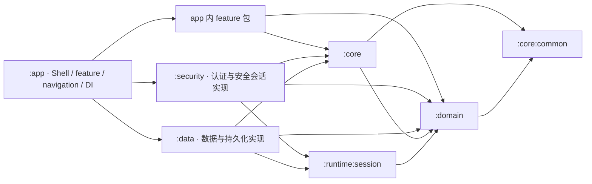
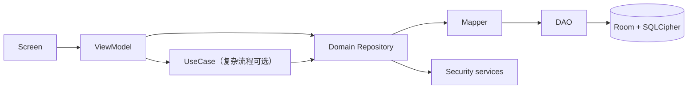

# 架构总览

Passly 只按稳定、可复用的技术边界拆分 Gradle 模块。业务 feature 保留在 `app` 内，以包组织职责；当前规模下
不再为每个页面或流程建立 `:feature:*` 模块，避免 API/implementation 空壳和过细依赖图。

当前模块：

- `:domain`：纯领域模型、端口与规则；当前包含 `access`、`entry`、`autofill`、`settings` 及共享敏感值语义；
- `:core:common`：Domain 可依赖的纯 Kotlin 错误与通用能力；
- `:core`：统一的 Android Core library，包含遥测、平台能力、共享 Compose UI 及密码学安全编排；因
  Argon2 为 AAR，此模块是 Android library，但源码不反向依赖 Data 或 App。包内用 `core.crypto` 承载
  无状态 AES/KDF/字段加密，用 `security.dek`、`security.envelope`、`security.search` 承载密钥生命周期与
  加密搜索；
- `:runtime:session`：资源无关的安全会话状态机与租约管理；
- `:security`：认证方式执行、授权、Android Keystore 适配与安全会话编排；只依赖稳定的 Domain/Core/Runtime
  契约，不依赖 Data 实现或 Feature UI；
- `:data`：Room、Proto DataStore、Repository、Mapper 与加密诊断存储实现；
- `:app`：应用壳、导航、平台入口、Notice 运行时和全部业务 feature。Backup 的协议、格式与稳定键映射
  位于 `feature/backup/internal/archive`；直接访问 Room 的快照适配位于 `app/database/backup`。

## 依赖方向



Data 自己拥有 Repository、存储与数据策略的 Hilt binding。App 负责业务流程和 Android 入口；Backup 的
数据库快照代码是一个明确、局部的数据集成点，其他 feature 继续通过 Domain 契约使用 Data。

Domain 不按 UI 页面镜像目录，但可为跨平台入口共享的稳定业务契约建立能力包。`autofill` 的候选、作用域和
Repository 端口属于这种契约；Android Autofill/Credential Manager 编排仍属于 App。`backup`、通知和数据库
生命周期属于 App/Data/Runtime 边界，不在 Domain 中建立同名协议实现。应用偏好由 `domain/settings` 下按职责拆分的
模型与端口统一表达，Data 只负责两个 Proto DataStore 的映射和实现（`data/local/datastore` +
`data/repository/settings`）。领域内部只使用 `model`、
`policy`、`port` 等少量稳定职责目录；只有关系、查询、凭据等确有独立不变量的 Entry 子概念才
继续分组。

`verifyModuleBoundaries` 校验每个真实 Gradle 模块的直接项目依赖白名单和依赖环，并自动接入各模块的
`check` 生命周期。新增模块必须先声明允许的依赖方向；未加入依赖的实现类型不会进入编译 classpath，因此
类型可见性继续由 Kotlin/Java 编译器保证。`app/feature/<name>` 是代码组织边界，不伪装成 Gradle 模块。

## 安全职责

```text
core.crypto/       无状态密码学原语、AES-GCM 实现、字段加密、KDF
security.dek/      DEK 与派生密钥的生命周期（位于 :core）
security.envelope/ 密钥信封的创建、解封和验证（位于 :core）
security.search/   Blind Index 与分词（位于 :core）
security.keystore/ Android Keystore 适配
security.lock/     应用锁强度状态
security.authentication/ 认证方式和流程编排
```

认证回答“谁可以解锁、使用哪种凭据”；加密回答“数据和密钥如何保密”。认证可以调用加密与信封能力，但密码学
原语不依赖认证流程。

## 数据流



- UI 只消费 UI state 和一次性 effect，不读取 DAO/Entity。
- Domain Repository 使用领域模型，不暴露 Android、Room、Feature 类型。
- Data 在 Mapper 边界转换 Entity 与 Domain model，并负责持久化错误映射。
- 解密集中在 Repository/Security 协作边界；明文领域对象只在解锁会话中存活。

## Feature 与 UI

App 内按业务聚合：流程与平台适配放在 `feature/<name>`，对应的页面、ViewModel、UI state/effect 和导航放在
`feature/<name>/presentation`。同一业务内，非 UI 代码不导入 presentation；Android 入口需要启动页面时通过
`app` 层的显式启动适配器连接。跨 Feature 的纯视觉组件进入 `:core`，但必须通过参数或
Composable slot 接收文案和内容，不能依赖 app 的 `R` 或具体业务类型。只有出现真实的独立发布、显著构建隔离
或多宿主复用需求时，才重新评估 feature Gradle 模块。

推荐布局：

```text
feature/settings/                  业务动作与平台适配
feature/settings/presentation/     Route、ViewModel、UI state/effect、页面
domain/settings/                   纯业务规则与跨层契约
app/                               Android 入口与跨边界适配器
```

## UseCase 何时需要

单一 Repository 调用可由 ViewModel 直接编排。跨仓库事务、安全校验、恢复码创建/重置等具有业务不变量的流程使用
UseCase，避免把领域规则放进 Compose 或 Android 回调。

## 相关文档

- [包边界](package-boundaries.md)
- [运行时流程](runtime-flows.md)
- [Presentation 状态管理](../development/architecture-and-state.md)
- [安全总览](../security/overview.md)
- [ADR-0007：UseCase 可选](../decisions/ADR-0007-usecase-is-optional.md)

