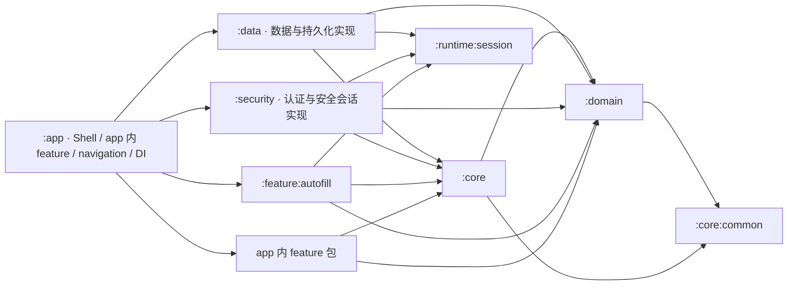
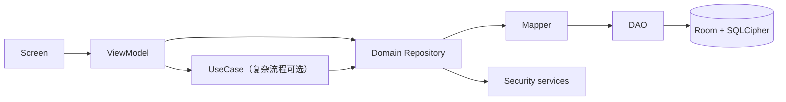

# 架构总览

Passly 按稳定、可复用的技术边界拆分 Gradle 模块。多数业务 feature 仍在 `:app` 内以包组织职责；Autofill
已独立为 `:feature:autofill`，因为它拥有可隔离的 Android 服务、候选编排、结果交付与 feature-level 测试边界。
不按页面或文件数量拆模块；其他拆分须由依赖闭包、构建隔离或真实复用需求证明收益。

当前模块：

- `:domain`：纯领域模型、端口与规则；当前包含 `access`、`entry`、`autofill`、`settings` 及共享敏感值语义；
- `:core:common`：Domain 可依赖的纯 Kotlin 错误与通用能力；
- `:core`：统一的 Android Core library，包含遥测、平台能力、共享 Compose UI 及通用密码学能力；因
  Argon2 为 AAR，此模块是 Android library，但源码不反向依赖 Data 或 App。包内用 `core.crypto` 承载
  无状态 AES/KDF/字段加密及 Data 使用的加密能力合同，不承载 `security.*` 实现；
- `:runtime:session`：资源无关的安全会话状态机与租约管理，不依赖 Domain；
- `:security`：DEK/字段/附件密钥生命周期、认证方式执行、授权、Android Keystore 适配与安全会话编排；只依赖稳定的 Domain/Core/Runtime
  契约，不依赖 Data 实现或 Feature UI；
- `:feature:autofill`：Autofill、Accessibility 与 Credential Manager 服务、候选/填充流程、结果交付和对应页面；
  只依赖 `:core`、`:domain`、`:runtime:session`，不依赖 App、Data 或 Security；
- `:data`：Room、Proto DataStore、Repository、Mapper 与加密诊断存储实现；
- `:app`：应用壳、全局导航、平台组合根、Notice 运行时、其他业务 feature 与跨模块适配。Backup 的协议、格式、稳定键映射
  与 `BackupSnapshotGateway` 归 App；`AppBackupSnapshotGateway` 只桥接归档模型和 Domain snapshot port，不直接访问 Room；Autofill 的认证 Activity
  宿主和窄 Android 平台适配仍由 App 提供。

## 依赖方向



Data 自己拥有 Repository、存储与数据策略的 Hilt binding。App 负责业务流程和 Android 入口；Backup 的
数据库快照代码是一个明确、局部的数据集成点，其他 feature 继续通过 Domain 契约使用 Data。

Domain 不按 UI 页面镜像目录，但可为跨平台入口共享的稳定业务契约建立能力包。`autofill` 的候选、作用域和
Repository 端口属于这种契约；Android Autofill/Credential Manager 编排由 `:feature:autofill` 拥有，App 提供
认证 Activity 宿主及平台适配。`backup`、通知和数据库
生命周期属于 App/Data/Runtime 边界，不在 Domain 中建立同名协议实现。应用偏好由 `domain/settings` 下按职责拆分的
模型与端口统一表达，Data 只负责两个 Proto DataStore 的映射和实现（`data/local/datastore` +
`data/repository/settings`）。领域内部只使用 `model`、
`policy`、`port` 等少量稳定职责目录；只有关系、查询、凭据等确有独立不变量的 Entry 子概念才
继续分组。

`verifyModuleBoundaries` 校验每个真实 Gradle 模块的直接项目依赖白名单和依赖环，并自动接入各模块的
`check` 生命周期。`:feature:autofill` 的白名单为 `:core`、`:domain`、`:runtime:session`，并要求 `:app`
直接依赖该模块；新增模块必须先声明允许的依赖方向。未加入依赖的实现类型不会进入编译 classpath，因此
类型可见性继续由 Kotlin/Java 编译器保证。`app/feature/<name>` 是多数 App 内业务的代码组织边界，不伪装成
Gradle 模块。

## 安全职责

```text
core.crypto/       无状态密码学原语、AES-GCM 实现、字段加密、KDF
security.dek/      DEK、敏感字段与附件密钥生命周期（位于 :security）
security.envelope/ 密钥信封的创建、解封和验证（位于 :security）
security.authentication.flow/ 认证请求、方式选择与结果处理
security.authentication.method.* 生物识别、凭据执行与配置
security.authentication.host/ 平台认证 UI 宿主
security.session/ 认证、锁定与数据库会话协调
security.authorization/ 授权签发、验证与撤销
security.lock/     应用锁强度状态
```

认证回答“谁可以解锁、使用哪种凭据”；加密回答“数据和密钥如何保密”。认证可以调用加密与信封能力，但密码学
原语不依赖认证流程。

## 数据流



- UI 只消费 UI state 和一次性 effect，不读取 DAO/Entity。
- Domain Repository 使用领域模型，不暴露 Android、Room、Feature 类型。
- Data 在 Mapper 边界转换 Entity 与 Domain model，并负责持久化错误映射。
- 解密集中在 Repository/Security 协作边界；明文领域对象只在解锁会话中存活。

## Feature 与 UI

多数业务在 App 内按业务聚合：流程与平台适配放在 `app/feature/<name>`，对应的页面、ViewModel、UI state/effect
和导航放在其 `presentation` 子包。Autofill 则整体位于 `:feature:autofill`，只有认证 Activity 宿主和窄平台
适配在 App。各 Feature 内非 UI 代码不导入 presentation；Android 入口启动页面时通过所属 Feature 的稳定宿主合同
连接。跨 Feature 的纯视觉组件进入 `:core`，但必须通过参数或
Composable slot 接收文案和内容，不能依赖 app 的 `R` 或具体业务类型。只有出现真实的独立发布、显著构建隔离
或多宿主复用需求时，才评估新增 feature Gradle 模块；Autofill 模块已经落地，不是待拆候选。

推荐布局：

```text
feature/settings/                  业务动作与平台适配
feature/settings/presentation/     Route、ViewModel、UI state/effect、页面
domain/settings/                   纯业务规则与跨层契约
app/                               Android 入口与跨边界适配器
```

## UseCase 何时需要

ViewModel 可直接执行简单的单一 Repository 读取或写入。UseCase/应用服务封装一个完整且有意义的业务动作：它可以只调用一个 Repository，也可以协调多个仓库、端口或安全能力；是否提取看动作是否包含业务规则、验证、不变量、事务/幂等要求、可复用流程或独立的错误/取消合同，而不是看 Repository 数量。简单一对一转发不建立 UseCase。

纯领域判断放在 Domain Policy/规则；应用或 feature 专属流程放在拥有该流程的 App/Application 层；持久化与数据映射仍由 Repository/Data 层负责。提取 UseCase 后应让 ViewModel 的依赖、分支或异步编排职责实际下降。UseCase 也应保持一个清晰业务动作，不成为多个 ViewModel 逻辑的集中垃圾桶。

## 相关文档

- [包边界](package-boundaries.md)
- [ViewModel 依赖与 owner 边界](viewmodel-ownership.md)
- [运行时流程](runtime-flows.md)
- [Presentation 状态管理](../development/architecture-and-state.md)
- [安全总览](../security/overview.md)
- [ADR-0007：UseCase 可选](../decisions/ADR-0007-usecase-is-optional.md)

## 代码位置

| 职责 | 类/函数 | 源码文件 |
| --- | --- | --- |
| Domain 创建规则与身份物化 | `EntryDraftMaterializer.materialize()` | [`EntryDraftMaterializer.kt`](../../domain/src/main/kotlin/com/aozijx/passly/domain/entry/policy/EntryDraftMaterializer.kt) |
| Data 数据库会话边界 | `AppDatabaseSession` | [`AppDatabaseSession.kt`](../../data/src/main/java/com/aozijx/passly/data/local/database/session/AppDatabaseSession.kt) |
| Security 认证与会话编排 | `DefaultAuthenticationManager`、`VaultSessionController` | [`DefaultAuthenticationManager.kt`](../../security/src/main/java/com/aozijx/passly/security/authentication/flow/DefaultAuthenticationManager.kt)、[`VaultSessionController.kt`](../../security/src/main/java/com/aozijx/passly/security/session/VaultSessionController.kt) |
| App 导航宿主 | `PasslyNavHost()` | [`PasslyNavHost.kt`](../../app/src/main/java/com/aozijx/passly/feature/shell/presentation/navigation/PasslyNavHost.kt) |
