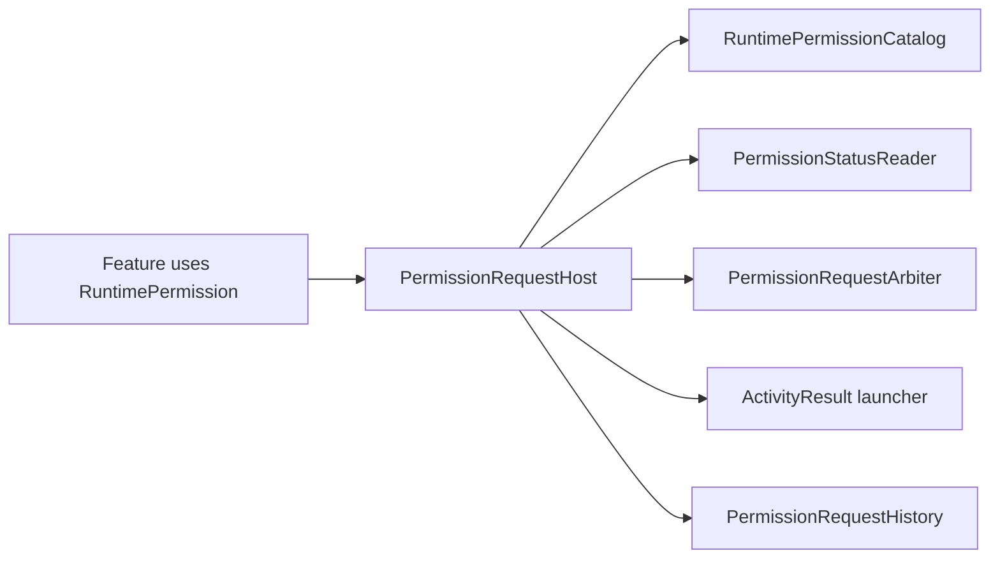

# 权限中心

## 模型

`RuntimePermission` 只包含应用实际请求的运行时权限：

| RuntimePermission | Android 权限 | 适用范围 | 请求所有者 |
|---|---|---|---|
| `CAMERA` | `CAMERA` | 所有支持版本 | 扫码入口 |
| `POST_NOTIFICATIONS` | `POST_NOTIFICATIONS` | API 33+ | 消息设置 |

`INTERNET`、`VIBRATE`、`USE_BIOMETRIC` 和 package visibility 属于 Manifest capability，
不能进入运行时 requester。应用不再声明 `QUERY_ALL_PACKAGES`；应用匹配依赖 `<queries>` 的 launcher intent
可见性，新增包查询场景必须先完成最小权限审计。

设置中的“权限管理”页把访问能力明确分成三类：

1. Camera、Notifications 等可请求的 Runtime permission；
2. 备份目录的 SAF persisted URI grant；
3. Network、Vibration、Biometric、Package visibility 等只读 Manifest capability。

三类能力不能共用 Boolean 或假装成开关。Manifest capability 只解释用途；SAF grant 由目录选择和
持久授权管理，不能映射成存储运行时权限。

## 请求流程

- feature 只能使用 `RuntimePermission`，不得拼写 `Manifest.permission` 或创建自己的 launcher。
- `PermissionStatusReader` 返回 `GRANTED`、`DENIED` 或版本不适用的 `NOT_APPLICABLE`。
- `PermissionRequestArbiter` 在整个进程中只允许一个系统权限弹窗 owner 持有 lease。
- `PermissionRequestHistory` 仅用于区分首次拒绝与永久拒绝，不存储授权真值。
- requester 返回明确的 start/outcome 类型，不使用 Boolean 表示多种状态。
- 产品开关与授权状态分离；永久拒绝后由 UI 引导系统设置，中心不自动循环请求。
- `PermissionRequestHost.access()` 每次从系统状态、请求历史和 rationale 计算
  `GRANTED`、`REQUESTABLE`、`SETTINGS_REQUIRED` 或 `NOT_APPLICABLE`，不缓存授权真值。
- `PermissionsRoute` 只拥有运行时权限的 Activity Result launcher、应用详情设置 Intent、生命周期刷新与用户反馈；
  `PermissionManagementScreen` 只渲染不可变状态并发送语义动作。
- 权限管理页进入和恢复到前台时重新读取运行时权限；请求结果返回后也立即刷新，因而能反映用户在
  系统设置中的授权或撤销。
- 页面只展示当前 Android 版本适用的运行时权限。`POST_NOTIFICATIONS` 在 API 33 以下不显示，
  不用无关的新权限替代不适用项。

## 备份目录访问

备份目录通过 `OpenDocumentTree` 和 persisted URI grant 管理，不声明也不请求
`READ_EXTERNAL_STORAGE`、`WRITE_EXTERNAL_STORAGE` 或 `MANAGE_EXTERNAL_STORAGE`。

`BackupDirectoryGrantInspector` 是目录授权状态的唯一 Android 读取者。权限管理页、备份页和实际导出
共用它，统一得到 `NOT_CONFIGURED`、`GRANTED`、`GRANT_MISSING` 或 `UNAVAILABLE`。权限管理页只展示
目录名与授权状态，并导航到备份设置；备份页是选择、更换、重新授权和清除目录设置的唯一 UI 所有者。
权限 ViewModel 只依赖 `BackupDirectoryStatusInteractor`，不能访问选择或清除操作。
清除只释放 grant 与设置，不删除已导出的文件。检查只验证 URI、persisted write grant 及
provider/tree 可用性，不创建、截断或删除文档。

新增运行时权限必须更新枚举、Catalog、Manifest、请求所有者、状态/拒绝测试和本表。Hilt EntryPoint
service locator、Boolean requester、旧 `AppPermission` 混合模型不得恢复。
