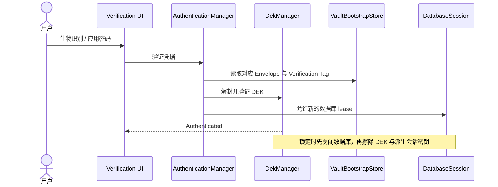
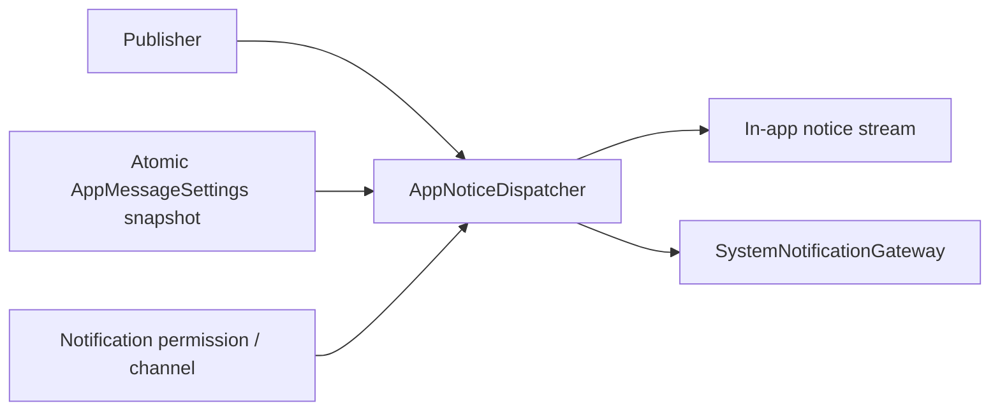

# 运行时流程

## 解锁与锁定

`VaultBootstrapStore` 位于数据库之外，使应用在 SQLCipher 尚未打开时也能取得信封。当前实现由 Proto DataStore
提供，DEK 解锁后 `DatabaseProvider` 才能创建 Room 实例。

运行时 session 从 `SessionKeySource` 取得专属密钥副本后交给资源打开；打开完成或失败都会擦除该副本。key source 和资源打开
的普通 `Exception` 分别映射为 `KeyUnavailable` 和 `OpenFailed`；`CancellationException` 继续传播，JVM fatal `Error`
在必要的资源清理后继续传播，不作为可重试的业务结果返回。若资源已创建后调用方取消或打开流程失败，RuntimeSessionManager
会在不可取消清理区撤销已发布句柄、尝试关闭新句柄并恢复 SEALED。清理期间的 fatal `Error` 会覆盖普通失败并保留原始失败为
suppressed；主失败本身为 fatal 时保持主错误并附加清理错误。key buffer 在 `unlock()` 的 `finally` 中归零。

调用顺序为 `RuntimeSessionManager.unlock()` → 检查 `leaseGate.closeFailure()` → 尝试
`leaseGate.resumeIfOpen()` → 在 `withContext(ioDispatcher)` 中调用 `keySource.copyKey()` →
`leaseGate.open(key)`。key source 的普通异常映射为 `KeyUnavailable(cause)`，资源打开普通异常映射为
`OpenFailed(cause)`；取消直接传播。fatal `Error` 先记录为待传播错误，使 dispatcher 区域执行 key buffer 的
`finally` 擦除，再从 `unlock()` 重抛同一 Error。`SessionLeaseGate.open(key)` 调用 `resource.open(key)` 后依次记录新
handle、发布 handle、更新 `UNLOCKED`，再调用
`emitTransition(startedAt, fromState, UNLOCKED, OPEN, NONE)`。失败时 `discardOpened(opened, published, cause)`
在 `NonCancellable` 中撤销已发布 handle、调用 `resource.close(opened)` 并恢复 `SEALED`；清理 Error 的优先级规则见上文。

状态事件只由 `emitTransition(startedAt, fromState, toState, reason, lockType, timeoutMs, activeLeaseCount, error)`
发送，事件 owner 固定为 `SESSION_RUNTIME`。此边界重抛 `CancellationException`、忽略普通 `Exception`，不捕获 fatal
`Error`；因此 sink 的普通失败不会回滚已发布状态，取消与 fatal 仍遵循调用方合同。

session transition event 由 `SessionEventSink` best-effort 记录，普通遥测 `Exception` 不回滚已提交的状态或资源操作；
取消和 fatal `Error` 仍向调用方传播。`DRAIN_TIMEOUT` 遥测失败会延后到 lease 取消和资源关闭完成后传播，因此日志可能缺少后续
的 `SEAL` 事件，但 session 仍保持 SEALED，且资源结果不由日志采集决定。生产的 `DatabaseSessionEventLogger` 将事件转为
结构化 Logger 记录；`DefaultLogger` 隔离普通日志 sink 错误，Runtime 边界继续处理 Logger 其余普通异常。

恢复码走独立流程：`RECOVER_AUTH_METHODS` 解封同一个 DEK 后只发布 `RecoveryMode`，不会发布普通
`Authenticated`。恢复页面不挂载 Vault 导航，只能重建主认证、用新备份密码执行 `RECOVERY_EXPORT`，或退出锁定。

Activity 只通过 `AuthenticationHost` 提供 UI 能力；认证请求本身不携带 Activity、Launcher、Cipher 或
PendingIntent。锁定由 `VaultSessionController` 撤权并发布 `Locking`，Runtime 随即拒绝新 lease。普通 drain 超时后只向活动 lease owner 发出取消请求；若操作忽略取消，锁定继续等待且 Room 保持打开，直到该 lease 实际退出，再在 IO dispatcher 关闭 Room、擦除会话密钥与 DEK。不会因固定宽限期结束就关闭仍在使用的句柄。

## 一次性消息

同一业务事件使用稳定 eventId；可信注册表决定等级、主题、投递目标和 eventId TTL。通知偏好控制产品行为，
系统权限决定状态栏通知是否可投递，两者不能混为一个布尔值。详细规则见[消息中心](message-center.md)。

## 备份

导出先生成一致性快照与附件，再写入 ZIP 负载，最后用备份密码派生的密钥进行 AES-GCM
加密。导入必须先完整验证容器、解密和校验路径，再在事务中执行覆盖或合并；失败不得留下部分数据。

详细格式见[Backup 归档协议](../features/backup/passly-archive-v1.md)。

## 代码位置

| 职责 | 类/函数 | 源码文件 |
| --- | --- | --- |
| 认证请求编排与 Vault 会话转换 | `DefaultAuthenticationManager`、`VaultSessionController` | [`DefaultAuthenticationManager.kt`](../../security/src/main/java/com/aozijx/passly/security/authentication/DefaultAuthenticationManager.kt)、[`VaultSessionController.kt`](../../security/src/main/java/com/aozijx/passly/security/authentication/VaultSessionController.kt) |
| DEK 生命周期与派生会话密钥 | `DekManager` | [`DekManager.kt`](../../core/src/main/kotlin/com/aozijx/passly/security/dek/DekManager.kt) |
| Runtime session 解锁、句柄清理与状态门控 | `RuntimeSessionManager.unlock()`、`SessionLeaseGate.open()` | [`RuntimeSessionManager.kt`](../../runtime/session/src/main/kotlin/com/aozijx/passly/runtime/session/RuntimeSessionManager.kt)、[`SessionLeaseGate.kt`](../../runtime/session/src/main/kotlin/com/aozijx/passly/runtime/session/SessionLeaseGate.kt) |
| 通知路由与派发 | `DefaultNoticeRouter.route()`、`DefaultAppNoticeDispatcher.dispatch()` | [`DefaultNoticeRouter.kt`](../../app/src/main/java/com/aozijx/passly/app/message/runtime/DefaultNoticeRouter.kt)、[`DefaultAppNoticeDispatcher.kt`](../../app/src/main/java/com/aozijx/passly/app/message/runtime/DefaultAppNoticeDispatcher.kt) |
