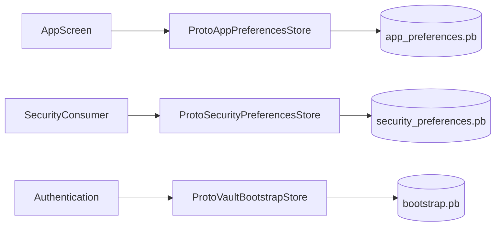

# 设置存储

Passly 使用两个 Proto DataStore 保存用户偏好：

- `app_preferences.proto` → `app_preferences.pb`：外观、界面、交互、自动填充、Vault 视图、消息和备份目录。
- `security_preferences.proto` → `security_preferences.pb`：安全窗口、锁定、生物识别密钥策略和剪贴板保护。

现有 `bootstrap.proto` → `bootstrap.pb` 保持不变，只由 Vault 认证流程按需读取。它不是常驻设置流，不能与
普通或安全偏好合并。

## 代码归属

- `:domain` 定义设置模型、约束和 repository 端口。
- `:data` 的 `preferences.proto` 生成包定义持久化 DTO；Serializer 负责损坏输入处理；两个 Store 分别映射
  自己的 DataStore。
- App 只消费 Domain 模型，不直接依赖生成的 Proto 类型。

`ProtoAppPreferencesStore` 不读写安全字段；`ProtoSecurityPreferencesStore` 不读写普通应用字段。页面需要两类状态时，
在既有 presentation 生命周期中组合两个 Flow，不创建第三个聚合存储。

## Proto 的边界

Proto 只保存已经存在读写入口、确实需要跨启动保留的用户选择。它不是业务规则容器。

适合进入 Proto：

- 主题模式、动态颜色开关、手动主题 key、语言和界面开关；完整色板由代码生成，不持久化画布染色比例。
- 下拉搜索、左右滑动作和自动填充用户选项。
- Vault 主排序、方向、收藏置顶和层级显示方式。
- 通知主题开关与最低等级。
- 用户通过 SAF 选择的备份目录。
- 锁定和剪贴板保护偏好。

不进入 Proto：

- 排序 tie-breaker、校验范围、状态机、错误降级和自动填充执行策略。
- 备份 sheet 的当前格式、包含项、导入模式等一次性工作流参数。
- 没有实际写入入口的预留字段。
- 页面加载、搜索词、弹窗、待处理 effect、缓存或日志占用等运行时状态。
- 密码、密钥、OTP secret、恢复码明文、会话密钥和附件正文。

## 默认值与读取

Proto2 的 `optional` 与 `[default = ...]` 定义首次安装和新文件的持久化偏好。Serializer 的 `defaultValue` 使用根消息
`getDefaultInstance()`；DataStore 文件不存在时直接发出该实例。Proto mapper 不写 `?: 60000` 或字符串 `else`
等持久化回退。需要持久化偏好的运行时状态在 DataStore 首次发值前保持未就绪，不用 Domain 或 Presentation
常量伪造一个已加载值。Domain 可以保留与持久化无关的构造默认值，但不得重新声明 Proto 偏好的默认选择。

固定选择使用以 `Preference` 结尾的 Proto enum，例如 `SwipeActionPreference`，避免与 Domain 类型重名和 `as`
别名导入。每个 enum 的 0 值为 `*_UNSPECIFIED`，字段显式指定合法默认值；Mapper 收到显式
`UNSPECIFIED` 时抛错，不猜测另一个合法选择。Proto2 遇到未来版本的未知 enum 数值时会把它保留为 unknown field，
当前生成的 getter 将该字段视为未设置并返回 schema 的显式默认值。

范围规范化和业务不变量仍留在 Domain。例如最大建议数和剪贴板延迟在写入时按 Domain 约束规范化，稳定排序的
tie-breaker 由 Domain 查询规则补充，不持久化。

## 加密与兼容边界

Proto DataStore 提供原子更新和结构化序列化，不自动加密整个文件。本项目未引入 Google Tink，原因见
[ADR-0009](../decisions/ADR-0009-no-google-tink.md)。

- `app_preferences.pb` 与 `security_preferences.pb` 只能保存非秘密偏好。
- `bootstrap.pb` 本身不是整文件密文；其中的 DEK 是由应用密码派生密钥或 Android Keystore 密钥包裹后的信封密文。
- 诊断日志使用自己的内部文件存储，不存在 `diagnostics_settings.pb`。

新的两个 preferences 文件不读取或迁移旧 `app_settings.pb`，也不保留兼容桥。旧文件仅包含非秘密偏好；升级后由
新 schema 的默认实例开始。Vault 数据库、密码与 `bootstrap.pb` 不受影响。

## 数据流

两个 preferences repository 直接映射 `DataStore.data`，沿用 Domain 的 Flow 端口。不为每个设置属性建立全局 eager
`StateFlow`、专用 CoroutineScope 或重复缓存。Vault 在持久化排序到达前不生成列表查询或排序菜单状态；首次排序为
创建时间降序、收藏置顶。下拉搜索和滑动操作默认关闭，启用滑动后左滑复制密码、右滑删除。这些值都来自
`app_preferences.proto`。

应用 Shell 在外观、界面和安全偏好全部到达前保持 `Loading`，不构造 Domain settings 默认实例冒充已加载值。加载期间
只应用独立的安全启动窗口策略：禁止截屏且不主动隐藏系统栏；主题、语言、圆角、导航和认证界面在偏好到达后创建。
Legacy Autofill、Credential Manager 和保存 Activity 通过同一个 persisted-theme host 等待外观与圆角偏好，不调用
无参数 `AppTheme()` 生成另一套默认主题。

消息 dispatcher 的同步读取接口使用 `MessageSettingsSnapshot.Loading/Ready`。在第一份 Proto 消息偏好到达前，事件以
`SETTINGS_UNAVAILABLE` 明确抑制，不用 Domain 构造默认值临时开启消息，也不占用事件去重 claim；偏好到达后再按
`Ready` 快照的版本和规则路由。

## Schema 演进规则

- 当前 preferences schema 按破坏性更新管理，不读取旧 `*.pb`，也不为已删除字段保留兼容解析路径；字段可随当前模型
  重新编号。首次发布需要兼容既有安装时，再切换为只追加字段、保留删除字段号和显式迁移的演进策略。
- 有非零默认值的 scalar 使用 `optional` 与 `[default = ...]`。
- 固定集合优先 enum；集合使用 `repeated`，不用逗号或分号拼接。
- 根消息不添加没有读取、拒绝或迁移行为的版本字段；需要迁移路由时，版本字段与规则一起引入。
- Serializer 遇到损坏输入抛出 `CorruptionException`，不静默重置整个设置文件。

消息通知权限和系统能力是交付条件，不是偏好值；相关设计见[权限与消息](../features/permissions-and-messages.md)。
