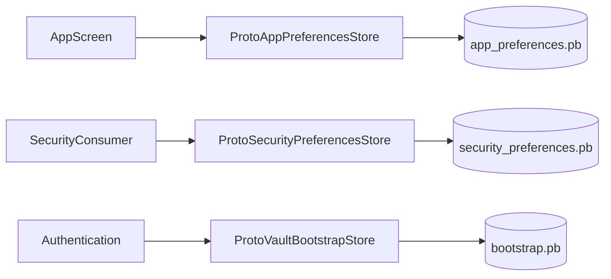

# 设置存储

状态：当前实现（代码核对：2026-11-06）。

Passly 使用两个 Proto DataStore 保存用户偏好：

- `app_preferences.proto` → `app_preferences.pb`：外观、界面、交互、自动填充、Vault 视图、消息和备份目录。
- `security_preferences.proto` → `security_preferences.pb`：安全窗口、锁定和剪贴板保护。

`bootstrap.proto` → `bootstrap.pb` 保存认证材料及其绑定元数据，与偏好存储分离。
生物识别策略只以已提交的 binding 为真相源；设置页通过 `BiometricConfigurationSource` 按需订阅
`NotConfigured / Configured` 的非敏感投影，不接收 alias、Envelope、密钥或轮换 journal，不建立全局 eager 缓存。
策略轮换不再向安全偏好二次写入，避免密钥已提交而页面仍显示旧偏好的跨存储不一致。

## 代码归属

- `:domain` 定义设置模型、约束和 repository 端口。
- `:data` 的 `preferences.proto` 生成包定义持久化 DTO；Serializer 负责损坏输入处理；两个 Store 分别映射
  自己的 DataStore。
- App 只消费 Domain 模型，不直接依赖生成的 Proto 类型。

`ProtoAppPreferencesStore` 不读写安全字段；`ProtoSecurityPreferencesStore` 不读写普通应用字段。页面需要两类状态时，
在既有 presentation 生命周期中组合两个 Flow，不创建第三个聚合存储。

应用语言提供跟随系统、简体中文和 English；Android 每应用语言列表注册 `zh-CN` 与 `en`。
外观与界面设置页直接传递 `ThemeMode`、`FontFamilyMode`、`EntryHierarchyDisplayMode` 和 `AppLanguage`；
语言选择项只附加本地化标签，页面内部不经由 enum 名称字符串往返转换。持久化键仍由 DataStore mapper 处理。

## Proto 的边界

Proto 只保存已经存在读写入口、确实需要跨启动保留的用户选择。它不是业务规则容器。

适合进入 Proto：

- 主题模式、动态颜色开关、手动主题 key、语言和界面开关；完整色板由代码生成，不持久化画布染色比例。
- 下拉搜索、左右滑动作和自动填充用户选项。
- Vault 主排序、方向、收藏置顶和层级显示方式。
- 通知主题开关与最低等级。
- 用户通过 SAF 选择的备份目录。
- 锁定和剪贴板保护偏好。

不进入 Proto：

- 排序 tie-breaker、校验范围、状态机、错误降级和自动填充执行策略。
- 备份 sheet 的当前格式、包含项、导入模式等一次性工作流参数。
- 没有实际写入入口的预留字段。
- 页面加载、搜索词、弹窗、待处理 effect、缓存或日志占用等运行时状态。
- 密码、密钥、OTP secret、恢复码明文、会话密钥和附件正文。

## 默认值与读取

Proto2 的 `optional` 与 `[default = ...]` 定义首次安装和新文件的持久化偏好。Serializer 的 `defaultValue` 使用根消息
`getDefaultInstance()`；DataStore 文件不存在时直接发出该实例。Proto mapper 不写 `?: 60000` 或字符串 `else`
等持久化回退。需要持久化偏好的运行时状态在 DataStore 首次发值前保持未就绪，不用 Domain 或 Presentation
常量伪造一个已加载值。Domain 持久化设置模型要求调用方提供完整字段；每个 Data mapper 从 Proto getter
读取 schema 默认值并构造完整快照。Domain 保留的范围约束、校验回退和查询排序策略属于业务规则，不代表已加载的持久化偏好。

固定选择使用以 `Preference` 结尾的 Proto enum，例如 `SwipeActionPreference`，避免与 Domain 类型重名和 `as`
别名导入。每个 enum 的 0 值为 `*_UNSPECIFIED`，字段显式指定合法默认值；Mapper 收到显式
`UNSPECIFIED` 时抛错，不猜测另一个合法选择。Proto2 遇到未来版本的未知 enum 数值时会把它保留为 unknown field，
当前生成的 getter 将该字段视为未设置并返回 schema 的显式默认值。

范围规范化和业务不变量仍留在 Domain。例如最大建议数和剪贴板延迟在写入时按 Domain 约束规范化，稳定排序的
tie-breaker 由 Domain 查询规则补充，不持久化。

## 加密与兼容边界

Proto DataStore 提供原子更新和结构化序列化，不自动加密整个文件。本项目未引入 Google Tink，原因见
[ADR-0009](../decisions/ADR-0009-no-google-tink.md)。

- `app_preferences.pb` 与 `security_preferences.pb` 只能保存非秘密偏好。
- `bootstrap.pb` 本身不是整文件密文；其中的 DEK 是由应用密码派生密钥或 Android Keystore 密钥包裹后的信封密文。
- 诊断日志使用自己的内部文件存储，不存在 `diagnostics_settings.pb`。

新的两个 preferences 文件不读取或迁移旧 `app_settings.pb`，也不保留兼容桥。旧文件仅包含非秘密偏好；升级后由
新 schema 的默认实例开始。Vault 数据库、密码与 `bootstrap.pb` 不受影响。

## 数据流

两个 preferences repository 直接映射 `DataStore.data`，沿用 Domain 的 Flow 端口。不为每个设置属性建立全局 eager
`StateFlow`、专用 CoroutineScope 或重复缓存。Vault 在持久化排序到达前不生成列表查询或排序菜单状态；首次排序为
创建时间降序、收藏置顶。下拉搜索和滑动操作默认关闭，启用滑动后左滑复制密码、右滑删除。这些值都来自
`app_preferences.proto`。

快捷筛选栏默认随滚动折叠；传统 Autofill 的展示模式默认是悬浮。Proto 中缺失这些字段时使用上述默认值，已显式保存的用户选择保持不变。

界面设置的系统栏、顶部栏折叠、快捷筛选栏折叠、圆角和条目层级写入共用 `writePreferenceWithFeedback`。
`InterfaceSettingsViewModel` 只从界面与列表偏好的 Flow 组合页面状态，不提前修改选择；写入成功保持静默，
失败经只读 `errors` Flow 发布 `UiErrorMessage`，不暴露内部异常文本。取消继续传播，页面销毁后的迟到失败不再通知。
`InterfaceRoute` 在 STARTED 生命周期内消费错误，在消费时用当前 `LocalResources` 解析文案。

### 设置读取与写入的函数调用链

以“隐藏系统栏”设置为例，`InterfaceSettingsViewModel.onAction(SetHideSystemBars(action.enabled))` 调
`saveSetting { settingsRepository.setHideSystemBars(action.enabled) }`。`saveSetting(write)` 只在
`uiState.value is Ready` 且 `pageEffects.currentOwner` 非空时启动 `viewModelScope.launch`，并把原写入闭包作为
`write` 参数传给 `writePreferenceWithFeedback(failureRes, onFailure, write)`；`onFailure` 绑定发起时的 owner，调用
`pageEffects.tryEmit(owner, errorMessage)`，已离开的页面不能接收迟到错误。

`writePreferenceWithFeedback` 先执行 `write()`。`CancellationException` 原样抛出；普通 `Exception` 先执行
`currentCoroutineContext().ensureActive()`，再用 `failureRes` 映射为本地 `UiErrorMessage` 并调用 `onFailure`；成功后
也执行 `ensureActive()`，然后才调用可选 `onSuccess`。它不捕获 fatal `Error`，也不把存储失败乐观写入页面选择。

最终 `ProtoAppPreferencesStore.setHideSystemBars(enabled)` 调
`updateInterface { hideSystemBars = enabled }`，继而 `update { current -> setInterfacePrefs(current.interfacePrefs.toBuilder().apply(block)) }`，
最后由 `dataStore.updateData { current -> current.toBuilder().apply { block(current) }.build() }` 原子更新 Proto。其他同组字段分别经
`setTopBarCollapsible(enabled)`、`setQuickFilterBarCollapsible(enabled)`、`setAppCornerRadius(radiusDp)` 或
`setEntryHierarchyDisplayMode(mode)` 进入对应 helper；圆角在写 Proto 前调用 `AppCornerRadiusConstraints.normalize(radiusDp)`。

读取一侧，`ProtoAppPreferencesStore.preferences` 是 `dataStore.data.tagCorruptSettingsData()`；属性 Flow 再通过对应的
`*ProtoMappings` 解码成完整 Domain 设置。普通设置共享一个 Proto 读取 owner，安全设置由独立的安全 Proto owner 读取；
各 Repository Flow 只投影自己拥有的设置类型，不再由 Domain 构造器补齐持久化默认值。映射保持按设置子消息拆分，
避免把不相关偏好合并为一个 Domain 聚合后，单个字段的无效枚举使所有设置消费者一起失败。`InterfaceSettingsViewModel` 将 `settingsRepository.interfaceSettings` 与
`librarySettingsRepository.libraryViewSettings` 传给 `combine`，转成 `InterfaceSettingsUiState.Ready`，再交给
`RecoverableRead(source, viewModelScope)`。其 `state` 的 `Loading / Ready / Failed` 映射为页面状态；读取异常后由
`RecoverableRead.retryWhen` 管理 owner 和重新订阅：`IOException` 显示 `Failed(IO)` 后按退避自动重试，损坏数据和其他普通
异常显示对应失败态并等待 `settingsRead.retry()`；`CancellationException` 与 fatal `Error` 不转换成页面失败。由于源 Flow
异常终止后不会自动复活，重试会重新收集 cold `source`，不是等待已终止的同一订阅恢复。

当前对应测试分别是 [`RecoverableReadTest`](../../app/src/test/java/com/aozijx/passly/app/settings/RecoverableReadTest.kt)
（IO 退避重试、损坏数据显式重试、跨 owner retry、取消传播）和
[`InterfaceSettingsViewModelTest`](../../app/src/test/java/com/aozijx/passly/feature/settings/presentation/appearance/InterfaceSettingsViewModelTest.kt)
（源异常可见并重订阅、写入失败保留 Repository 真相、成功静默、页面退出后迟到失败被拒绝）。

外观设置的五类偏好、隐私设置的六类偏好以及自动填充设置的九类偏好也使用同一写入边界。
自动填充严格 host 匹配选项由 Proto optional bool tag 9 保存，默认开启；它只控制候选匹配范围。
外观继续从 Shell 提供的持久化外观状态渲染，隐私与自动填充继续订阅各自 Repository Flow，
不通过写入回调直接修改页面选择。写入成功静默；存储失败映射为资源键，不传递异常文本，取消与迟到错误遵守上述规则。
外观与界面页共用 `ObserveSettingsWriteErrors`；隐私与自动填充在原事件流增加 `SaveFailed`，
各自 Route 在 STARTED 生命周期消费，当前语言变化会重建使用 `LocalResources` 的消费逻辑。
隐私页的手动清理剪贴板反馈同样按消费时语言解析；自动填充的系统设置导航仍是独立事件，保存失败不触发导航。

应用 Shell 在外观、界面和安全偏好全部到达前保持 `Loading`，不构造 Domain settings 默认实例冒充已加载值。加载期间
只应用独立的安全启动窗口策略：禁止截屏且不主动隐藏系统栏；主题、语言、圆角、导航和认证界面在偏好到达后创建。
Legacy Autofill、Credential Manager 和保存 Activity 通过同一个 persisted-theme host 等待外观与圆角偏好，不调用
无参数 `AppTheme()` 生成另一套默认主题。

消息 dispatcher 的同步读取接口使用 `MessageSettingsSnapshot.Loading/Ready`。在第一份 Proto 消息偏好到达前，事件以
`SETTINGS_UNAVAILABLE` 明确抑制，不用 Domain 构造默认值临时开启消息，也不占用事件去重 claim；偏好到达后再按
`Ready` 快照的版本和规则路由。

## Schema 演进规则

- 当前 preferences schema 按破坏性更新管理，不读取旧 `*.pb`，也不为已删除字段保留兼容解析路径；字段可随当前模型
  重新编号。首次发布需要兼容既有安装时，再切换为只追加字段、保留删除字段号和显式迁移的演进策略。
- 有非零默认值的 scalar 使用 `optional` 与 `[default = ...]`。
- 固定集合优先 enum；集合使用 `repeated`，不用逗号或分号拼接。
- 根消息不添加没有读取、拒绝或迁移行为的版本字段；需要迁移路由时，版本字段与规则一起引入。
- Serializer 遇到损坏输入抛出 `CorruptionException`，不静默重置整个设置文件。

消息通知权限和系统能力是交付条件，不是偏好值；用户偏好与权限申请见[通知设置](../features/settings/notification-settings.md)，
权限中心只展示平台状态，见[权限管理](../features/settings/permission-management.md)。

## 代码位置

| 职责 | 类/函数 | 源码文件 |
| --- | --- | --- |
| 持久化普通偏好 | `ProtoAppPreferencesStore` | [`ProtoAppPreferencesStore.kt`](../../data/src/main/java/com/aozijx/passly/data/repository/settings/ProtoAppPreferencesStore.kt) |
| 持久化安全偏好 | `ProtoSecurityPreferencesStore` | [`ProtoSecurityPreferencesStore.kt`](../../data/src/main/java/com/aozijx/passly/data/repository/settings/ProtoSecurityPreferencesStore.kt) |
| 读取 bootstrap 与生物识别轮换数据 | `ProtoVaultBootstrapStore`、`readBiometricConfiguration()` | [`ProtoVaultBootstrapStore.kt`](../../data/src/main/java/com/aozijx/passly/data/local/datastore/ProtoVaultBootstrapStore.kt)、[`BiometricConfigurationMapping.kt`](../../data/src/main/java/com/aozijx/passly/data/local/datastore/BiometricConfigurationMapping.kt) |
