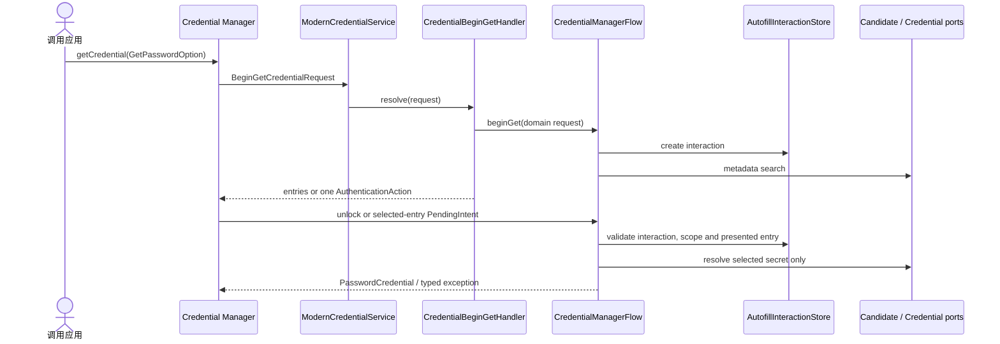

# Credential Manager Provider

状态：当前实现。

代码核对日期：2026-10-14。

适用范围：Android 14（API 34）及以上；传统 Autofill 见[自动填充安全](../security/autofill.md)。

## 支持范围

Passly 当前发布 `android.credentials.TYPE_PASSWORD_CREDENTIAL`，支持：

- 为原生 Android 应用展示已保存的用户名/密码候选；
- Vault 锁定时通过系统 `AuthenticationAction` 完成一次解锁并重新发现候选；
- 接收 `CreatePasswordRequest` 并通过正式 Entry 写事务新增登录条目；
- 响应系统 clear-state 请求并清理活跃 Credential Manager interaction。

暂不支持浏览器代表网站发起的 privileged-origin 请求、Passkey、远程条目、账号 sticky session 或按用户名 upsert。

## 组件边界

| 组件 | 职责 |
|---|---|
| `ModernCredentialService` | Android 回调、取消信号和异常边界 |
| `CredentialBeginGetHandler` | 解析 begin-get、调用共享发现、构造候选或解锁 action |
| `CredentialBeginCreateHandler` | 校验 create 类型/设置并创建保存 interaction |
| `CredentialRequestParser` | 从系统注入的最终请求读取调用方、option 和 create 数据 |
| `CredentialManagerFlow` | 编排共享授权、重发现、最终选择、保存和终态清理 |
| `CredentialResponseViewModel` | 将平台输入映射到 flow，再把类型化结果映射成 Android response |
| `CredentialPendingIntentFactory` | 创建显式 mutable PendingIntent，只附带不透明 ID |

平台 service/handler/factory 不得导入 Entry repository 或认证端口；认证和数据访问只存在于共享 Autofill 操作之后。

## 密码读取

查询阶段：

1. 只处理 `BeginGetPasswordOption`；调用包必须来自 `callingAppInfo`，privileged origin 被拒绝。
2. `DiscoverAutofillCandidates` 原子读取当前设置，建立 `AutofillInteractionId`，并查询元数据候选。
3. 锁定时只返回一个 `AuthenticationAction`；候选不会在未授权状态下查询。
4. 可用时，每个 `PasswordCredentialEntry` 同时携带 interaction ID 和 entry ID；不同 password option 仍绑定各自的 AndroidX option。
5. `allowedUserIds` 在展示前过滤；过滤后没有条目时立即取消 interaction。

最终选择阶段：

1. `CredentialRequestParser` 用 `PendingIntentHandler.retrieveProviderGetCredentialRequest()` 读取系统最终请求。
2. 调用包只取自该请求；extras 中的 interaction/entry ID 只是 Passly 内部指针。
3. `ResolveAutofillSelection` 检查 interaction 存在、作用域相同、状态已授权且 entry ID 确实展示过。
4. 只在检查后由 `AutofillCredentialResolver` 读取单条密码，并再次验证 `allowedUserIds`。
5. 成功后生成带 interaction/entry 收据的 Credential Manager 响应；Activity 先以 `RESULT_OK` 发布 `GetCredentialResponse`，随后把平台无关收据交给 `AutofillResultDelivery`。它不会复用或转换 Legacy `Dataset`/`FillResponse`。

## 解锁与重发现

解锁 PendingIntent 携带原 interaction ID，系统同时注入原始 `BeginGetCredentialRequest`：

1. `AuthorizeAutofillInteraction` 对该 interaction 执行 `AuthenticationPurpose.AUTOFILL`；
2. 成功后 `DiscoverAutofillCandidates` 使用同一个 ID 重新查询；
3. 后续选择直接消费同一个已授权 interaction，不再发起第二次认证；
4. 取消、失败、作用域变化或 interaction 丢失都会返回 Credential 异常并清理状态。

interaction 只存在于当前进程。进程死亡后，旧 PendingIntent 不能从 extras 恢复授权；选择会被拒绝，Android 需要重新发起 begin-get。

## 密码创建

`CredentialBeginCreateHandler` 只接受 `BeginCreatePasswordCredentialRequest`。设置允许且调用方有效时，它建立一个 Credential Manager interaction，并返回禁止 auto-select 的 `CreateEntry`。

Credential Manager 创建只受 Autofill 总开关和 Credential Manager 开关控制，不读取传统 Autofill 的“保存新登录”开关。反方向也相同：Credential Manager 开关不控制 Legacy `SaveInfo` 或 `SaveCallback`。两者只复用类型化草稿持久化和认证/lease 基础设施，不复用 Android 结果对象。

最终阶段：

1. 用 `retrieveProviderCreateCredentialRequest()` 取得系统注入的调用方和 `CreatePasswordRequest`；
2. 校验 interaction 作用域；Vault 锁定时只认证一次，已解锁时不做多余认证；
3. `SaveAutofillCredential` 构造类型化 `EntryDraft`，复用正式条目校验与物化流程，再通过仅接受 Autofill
   临时会话的 `AutofillEntryWriter` 窄入口写入；
4. 保存成功完成 interaction，失败或取消则取消 interaction 并释放 Autofill 解锁 lease。

创建当前始终是新增登录条目，不执行去重或 upsert。

## PendingIntent 契约

| Action | 自定义 extras | 系统注入 |
|---|---|---|
| `ACTION_GET_PASSWORD` | interaction ID、entry ID | `ProviderGetCredentialRequest` |
| `ACTION_UNLOCK` | interaction ID | 原始 `BeginGetCredentialRequest` |
| `ACTION_CREATE_PASSWORD` | interaction ID | `ProviderCreateCredentialRequest` |

- PendingIntent 为显式 Activity，使用 `FLAG_MUTABLE | FLAG_UPDATE_CURRENT`。
- request identity 同时包含 interaction ID；不同交互不会因为相同 entry ID 复用旧 PendingIntent。
- 有效响应和有效 Credential 异常都使用 `RESULT_OK`；仅无法构造协议响应时使用 `RESULT_CANCELED`。

## 生命周期与 clear state

- 普通选择和创建是终态；解锁返回候选是中间态，不会提前释放 interaction。
- 成功响应由 Credential Manager Activity 在 `setResult(RESULT_OK, ...)` 后调用共享的 session 收尾操作；返回键、协程取消和异常路径统一取消 interaction。该 Activity 的结果合同与 Legacy Autofill 保持独立。
- Credential Manager 创建始终返回 Credential Provider response 或异常；它不构造 Legacy `SaveInfo`、`SaveCallback` continuation 或 `Dataset`。
- 每个 interaction 有 60 秒 process-local 超时，用于回收被系统选择器遗弃的请求；认证或解析秘密中的活跃操作会延后回收。
- `onClearCredentialStateRequest()` 会过期所有 Credential Manager interaction；它不会删除条目，也不会锁定本来就由用户解锁的 Vault。

## 回归要求

至少覆盖：锁定 begin-get、解锁后重发现、同 interaction 选择且只认证一次、作用域与 allowed-user 拒绝、锁定创建只认证一次、创建取消清理、PendingIntent identity 和 source-boundary 规则。

## 相关实现

- [ModernCredentialService](../../app/src/main/java/com/aozijx/passly/feature/autofill/credential/service/ModernCredentialService.kt)
- [CredentialManagerFlow](../../app/src/main/java/com/aozijx/passly/feature/autofill/credential/CredentialManagerFlow.kt)
- [CredentialRequestParser](../../app/src/main/java/com/aozijx/passly/feature/autofill/credential/CredentialRequestParser.kt)
- [CredentialResponseViewModel](../../app/src/main/java/com/aozijx/passly/presentation/feature/autofill/credential/CredentialResponseViewModel.kt)
- [AutofillInteractionStore](../../app/src/main/java/com/aozijx/passly/feature/autofill/runtime/AutofillInteractionStore.kt)
