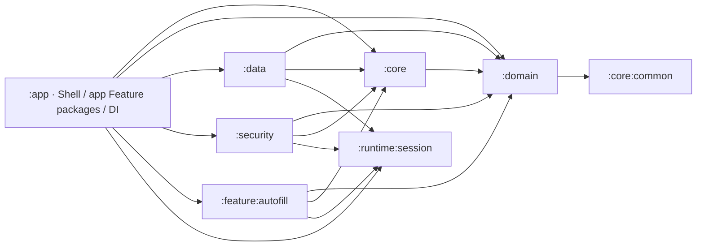
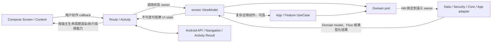
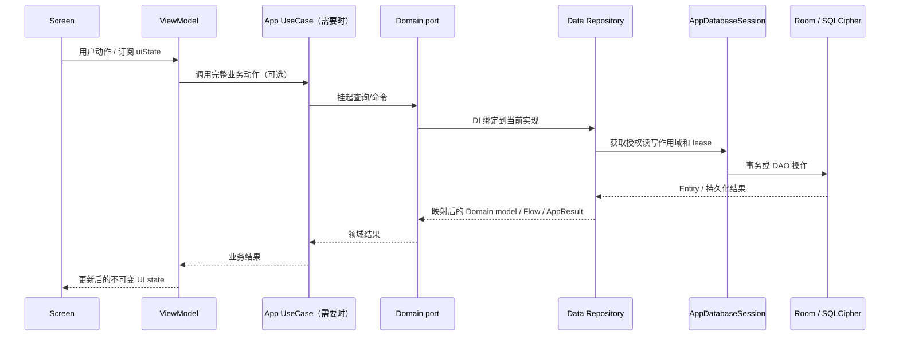

# 层间契约与通信

状态：当前架构规范。本文把 Android 官方分层建议映射到 Passly 的模块、端口、运行时调用和错误/生命周期合同。官方建议是可按项目需求调整的指导；Passly 的本地要求会明确标出，不把当前实现误写成 Android API 的强制规则。

## 官方分层与 Passly 的选择

Android 推荐以 UI、Data 为基本层，并可按需要加入 Domain layer，封装复杂或跨 ViewModel 复用的业务逻辑。Repository 是其他层访问应用数据的入口；UI 使用单向数据流，状态向 UI 下行、用户动作向状态 owner 上行。模块化建议按高内聚、低耦合组织，没有适用于所有项目的唯一目录或模块模板。[Android 架构指南](https://developer.android.com/topic/architecture)、[Domain layer 指南](https://developer.android.com/topic/architecture/domain-layer)、[Data layer 指南](https://developer.android.com/topic/architecture/data-layer)、[模块化模式](https://developer.android.com/topic/modularization/patterns)。

Passly 采用依赖倒置语义下的 `:domain`：它包含领域模型、稳定业务规则和能力端口，而不只是 Android 指南所说的可选 UseCase 层。数据端口通常由 `:data` 实现；认证、授权与会话端口由 `:security` 实现；个别应用流程端口由 `:app` 的 UseCase 实现；共享技术合同可由 `:core` 声明、由 Security 或 Core 能力实现。UseCase 放在实际拥有该流程的 App/Feature/Application owner，不为每个 Repository 调用机械增加一层。

## 两种方向：编译依赖与运行时调用

编译依赖指一个模块可以引用哪些类型；运行时调用指某个能力的消费者调用哪个端口实现。依赖倒置会让这两种箭头看起来相反，阅读或修改代码时必须分别核对。

`:app` 内的 `app/feature/<name>` 是源码包边界，不是独立 Gradle module。只有 `:feature:autofill` 是当前业务 Feature Gradle module；不要把 app Feature 包误读成模块箭头。`:app` 当前直接依赖 `:core`、`:data`、`:domain`、`:feature:autofill`、`:runtime:session` 和 `:security`；实际 allowlist 以 [`package-boundaries.md`](package-boundaries.md) 和各模块 `build.gradle.kts`/架构 verifier 为准。

图中的 Domain port 是消费者依赖的稳定契约；它本身不反向调用实现模块。Hilt 在组合图中把接口与 owner 实现绑定，运行时调用具体实现。App 负责根组件、导航和跨模块平台适配；各模块在自己的边界声明实现绑定，不能通过 DI 把非法模块依赖“隐藏”起来。

### Hilt 绑定由实现 owner 声明

`PasslyApplication` 是 `@HiltAndroidApp` 组合根，Hilt 从 App 可见的 Gradle 依赖图中收集 `@InstallIn` 模块。组合根创建对象图，但不因此拥有每个实现：

- Data 的 `EntryPersistenceModule` 把 Domain `EntryCommandRepository`、查询端口绑定到 Room Repository；`VaultStorageModule` 把数据库 session adapter 暴露为 session 端口。
- Security 的 `SensitiveKeyModule` 把 Core `SensitiveFieldCryptor` / `AttachmentContentProtector` 能力合同绑定到 Security 实现。Data 只注入 Core 接口，所以 Data 不必依赖 Security 实现包。
- App 的 `EntryCreationModule` 把 Domain `EntryCreation` / `AutofillEntryCreation` 能力绑定到 App `CreateEntryUseCase`，因为创建流程的验证、授权门控和应用日志由 App 流程 owner 组合。

新增绑定时同时验证三件事：端口是否属于正确层、实现是否由真正拥有其生命周期/副作用的层声明、使用方模块在 Gradle 图中是否显式依赖允许的契约模块。禁止用 App 里的转发 adapter 掩盖错误所有权，也禁止让 Hilt 图成为反向源码依赖的理由。

## 各层所有权和允许的交互

| Owner | 拥有的事实/职责 | 对外交互 | 不应跨越的边界 |
| --- | --- | --- | --- |
| UI / Compose Content | 当前组合内的视觉状态和渲染 | 接收不可变 UI state；把用户意图通过 callback 交给 Route/状态 owner | 不直接持有 Repository、DAO、DataStore、Security 实现或另一个 ViewModel |
| Route / Activity / Service | Android 宿主生命周期、导航、权限、Activity Result、资源文案、系统 UI | 生命周期感知地收集状态；把宿主输入转为 owner 方法调用；执行必要的 Android effect | 不成为业务真相源；不把 `Context`、`NavController` 或平台对象塞进 ViewModel/Domain |
| ViewModel | screen/destination 级 UI state 和页面任务 | 依赖 Domain 端口、应用服务或 UseCase；从 Flow/挂起操作产生可观察 UI state | 不依赖 Data/Security 实现；不把 Repository 数据复制成另一份可独立写入的长期真相 |
| App / Feature workflow | 应用或 Feature 专属业务流程、多端口编排和跨平台适配 | 调用 Domain 能力端口、纯 Domain Policy 和其他明确应用端口；通过 DI 接收实现 | 不把 DAO/Entity/Room session 暴露给页面；不代替可复用领域不变量 |
| `:domain` | 领域值、规则、端口和持久化中立结果 | 用 Kotlin 类型定义调用方需要的能力和返回合同；纯规则不依赖 Android | 不依赖 Data、App、Feature、Security 实现、Room、DataStore 或 UI 类型；当前仅分页端口明确允许 `paging-common` |
| `:data` | Room、Proto DataStore、文件数据、Repository 实现、存储映射及数据事务 | 实现 Domain 数据端口；使用 Core 的技术能力合同和 Runtime session 合同 | 不持有页面状态/导航/业务 UI；不让 DAO、Entity、密文格式或 Room 句柄泄漏到上层 |
| `:security` | 认证、授权、DEK/字段密钥生命周期、锁定与安全会话编排 | 实现 Domain 访问/认证端口；实现 Core 定义的密钥相关加密能力合同；协调 Runtime session | 不依赖 Data/Room 实现；不能只凭普通调用方传来的身份或页面状态授予访问权 |
| `:runtime:session` | 与 Android/Domain 资源类型无关的 session 状态机、lease 和关闭顺序 | 向 Security/Data 提供生命周期合同；由具体资源适配器执行 open/read/write/close | 不依赖 Domain、Room 或认证 UI；取消请求不等于资源操作已退出 |
| `:core` / `:core:common` | 被多个 owner 使用的技术原语、稳定能力合同、通用错误 | 提供类型安全的能力给 Domain/Data/Security/App | 不反向依赖 Data、App 或 Feature 实现，不成为无 owner 的业务工具箱 |

这是职责说明，不意味着每个功能必须经过所有层。简单的单仓库读写可由 ViewModel 直接调用 Domain Repository port；只有存在完整业务动作、验证、不变量、多个端口编排、复用或独立错误/取消合同时才建立 UseCase/Application service。

## 跨层使用什么类型通信

| 交互 | 常用合同 | 约束 |
| --- | --- | --- |
| 一次性读取/命令 | Kotlin `suspend fun` | 端口返回 Domain/应用结果；由声明该能力的 owner 处理普通失败；不要把 DAO/Entity 当结果传出 |
| 持续观察数据 | `Flow<T>` | Repository/数据源暴露可观察数据；消费端要规定失败 owner、可见失败态和重新订阅/重试；Room/DataStore 的持久数据不能靠长期 UI 缓存取代 |
| Repository 命令失败 | 端口定义的类型化 `AppResult`/领域错误，或明确的异常合同 | 调用方按合同穷尽处理；不要在每层重复包装同一错误，也不要把存储失败伪装成成功或默认值 |
| UI 状态 | 不可变 `UiState`，通常通过只读 `StateFlow` 发布 | ViewModel/状态 owner 单一发布；Route 用 lifecycle-aware API 收集；多个互不相关的 state stream 可以分开，需各自定义初始和失败状态 |
| 用户动作 | Screen/Content 回调到 Route 或 ViewModel 的语义方法；必要时使用穷尽 `UiAction` | 事件向状态 owner 上行；简单字段更新不需要 Action→Event→Reducer 多层转发 |
| 平台交互 | Route/Activity/Service 的 Android API 与生命周期合同 | 状态 owner 提供当前状态或待处理反馈；宿主在正确 Lifecycle 阶段处理导航、权限、系统调用和 callback；一次性 VM→UI 事件不作默认状态通道 |
| 纯模型转换 | Domain Policy、Data Mapper/Codec、Presentation UiMapper | 按输入/输出模型与规则所有权放置；Mapper 不做 I/O，Reducer 只转换它拥有的状态 |

Android 官方建议 UI 遵循 UDF、使用 Flow/suspend 进行层间通信、通过 Repository 暴露数据，并以不可变对象表达数据；ViewModel 通常通过 `StateFlow` 暴露 `uiState`，Compose 使用 `collectAsStateWithLifecycle()`。[UI layer 指南](https://developer.android.com/topic/architecture/ui-layer)、[架构建议](https://developer.android.com/topic/architecture/recommendations#ui-layer)。Passly 进一步要求把 session 撤权、异常恢复、敏感值清理和 durable commit 作为明确合同。详见[Presentation 状态管理](../../engineering/development/architecture-and-state.md)、[ViewModel owner 边界](viewmodel-ownership.md)、[错误处理](error-handling.md)。

## Domain：规则、端口和 UseCase 的协作

### 领域模型与端口

- Domain model 描述业务语义，不复制 Room Entity、Proto message、Activity Result 或归档格式。
- Domain port 表达消费者需要的能力，而不是实现技术。例如 `EntryCommandRepository` 描述创建/编辑/回收站命令；`EntryPagingRepository` 以领域 `EntryListQuery` 查询 `EntryListItem`；`EntryCreation` 描述创建能力，具体流程由 App 的 `CreateEntryUseCase` 实现。
- 端口可以由不同层实现。调用方编译依赖端口，运行时通过 Hilt 绑定到 Data、Security、Core 或 App owner；不要求所有接口都由 Data 实现。
- 外部/持久化稳定键由边界 mapper 显式穷尽映射。Domain enum 名称和序号不是数据库、Proto 或备份协议。

### Policy、UseCase 与 Repository 的分工

| 类型 | 输入/输出 | 适合放置的逻辑 | 不负责 |
| --- | --- | --- | --- |
| Domain Policy / 规则 | 领域值 → 判断/归一化/新领域值 | 跨入口成立的业务不变量、校验、关系规则 | Android、I/O、页面文案、事务生命周期 |
| Domain port | 能力请求 → suspend/Flow/结果 | 规定调用者与能力 owner 的稳定合同 | 决定 Room/Proto 等具体实现 |
| Repository 实现 | 端口请求 → 持久事实/领域结果 | 数据来源协调、映射、事务、持久化错误和缓存/同步策略 | 页面流程、Route effect、领域模型外泄 |
| App/Feature UseCase | 一个有名业务动作 → 类型化结果 | 多端口编排、授权前置、验证与提交顺序、幂等/重试语义 | 复制完整 Domain 规则或简单透传 CRUD |
| ViewModel | 页面动作/Flow → UI state | 页面草稿、展示投影、页面任务编排 | 充当数据库事实源或跨页面万能业务服务 |

Passly 的 Domain module 与 Android 官方可选 UseCase layer 不是同一概念：`:domain` 是公共合同与纯规则层；业务 UseCase 可以在 App/Feature，因为它拥有应用流程与 Android 组合依赖。某些真正跨入口且不依赖平台的完整业务规则可属于 Domain。以当前代码为例，`CreateEntryUseCase` 实现在 App，依赖 Domain `EntryCreation` / `EntryCommandRepository` / `EntryDraftMaterializer` 合同；Data 只实现命令持久化，不接管整个应用创建流程。

## Data、Core、Security 与 Runtime 如何协作

### 数据读取和写入

图示为可能的端到端链路，不要求所有读取经过 UseCase。具体合同：

- Data 通过 Repository 作为上层数据入口。单一来源可由 Repository 直接使用 DAO/DataStore；只有真实多源协调、共享数据访问策略或独立测试边界值得抽取 DataSource。
- Room 与 Proto DataStore 是不同数据类型的持久事实来源：Vault 持久记录/附件引用由 Room 管理，设置值由对应 Proto 存储管理。Room Entity、Proto DTO、领域对象和 UI state 是不同投影，不能互相声称拥有同一持久字段。
- 查询/命令要经过 Domain port；Room 安全访问还必须经 `AppDatabaseSession` 与授权/lease gate。DAO 和 `AppDatabase` handle 不得缓存到 lease 之外；会话锁定拒绝新访问，并等待已取得 lease 实际退出后关闭仍在使用的资源。
- Core 可声明 Data 使用的密码学能力合同；当前 `SensitiveFieldCryptor`、`AttachmentContentProtector` 合同位于 Core，而由 Security 实现并在 Hilt 中绑定。Data 依赖能力接口，不依赖 Security 的密钥管理实现；Security 拥有密钥生命周期。
- `:runtime:session` 提供资源无关的 lease/生命周期合同。Data 的 `AppDatabaseSession` 适配 Room 资源，Security 的 session owner 协调认证撤权、Runtime 转换和密钥擦除；调用 `Job.cancel()` 只发取消请求，不能当作事务或 native 操作已退出。
- Security 与 Data 会通过不同 owner 的稳定合同双向协作：Data 的 `AppDatabaseSession` 读取由 Security 提供的 Domain `SecureSessionAccessState`，并暴露 Runtime `DatabaseSessionLifecycle` 给 Security 的 Vault session/reset coordinator；密钥加解密则走 Core contract。源码依赖仍是 Data/Security 各自依赖 Domain/Core/Runtime，不互相引用实现。这些合同定义撤权 admission point、lease 与关闭顺序，不能用普通 callback 或 ViewModel 状态代替。
- Repository Flow 是持久数据变化的观察接口；普通异常、授权撤销取消、正常空数据有不同语义。Flow 异常终止后的重新订阅必须由明确 owner 再收集冷源；不能把查询异常吞成空列表。

### 代表性调用链

**Vault 列表读取**：`VaultRoute` lifecycle-aware 收集 `VaultViewModel` 状态；ViewModel 组合 Domain settings ports、`EntryListQueryRepository` 与 `EntryPagingRepository`，将 `EntryListItem` 映射为展示投影后传给 Screen。页面只认识 UI model，不创建 Room 查询。当前实现分别暴露 `uiState`、`displayState`、分页 `entries` 与高频 OTP 状态；分成多个 Flow 是不同更新频率/owner 的选择，不改变 UDF。

**创建条目**：Screen 用户输入到页面状态 owner；应用创建流程通过 `EntryCreation` 调用 `CreateEntryUseCase`，验证 `EntryDraft`、经 Domain `EntryDraftMaterializer` 生成领域对象，再调 `EntryCommandRepository`。Data 的 Room 实现经事务入口和 `AppDatabaseSession` 提交；成功/失败沿 `AppResult` 回到 ViewModel，页面只把必要结果显示为 UI state/受限宿主反馈。Data 不决定表单文案，也不替代领域验证或 App 操作日志策略。

**敏感字段读取/加密**：应用流程先取得相应授权合同；Data Repository 消费 permit 和 `AppDatabaseSession` 访问边界，`SecretFieldCodec` 调用 Core 定义、Security 实现的加密能力。授权范围、字段键、记录 AAD 与密钥上下文不能由 UI Mapper 或普通 Repository wrapper 绕过。UI state 不持有 DEK/派生密钥；可编辑敏感草稿应定义清理时机。

**设置观察**：ViewModel 观察 Domain Settings Repository Flow；Data 的 `ProtoAppPreferencesStore` 将 DataStore 记录映射为各自 Domain 设置。页面根据 Loading/Ready/Failed 构造 UI projection；读取损坏或 I/O 失败不能替换成默认偏好，Retry owner 需重新订阅已终止的 cold Flow。

上述代码位置和完整参数/事务细节见[数据映射](../data/mapping.md)、[数据库与 Session](../data/database.md)、[设置存储](../data/settings-storage.md)。

### 跨模块集成的特例

- **Backup**：版本化归档协议、稳定键和文件选择器由 App/Backup Feature 持有；持久化中立的 `VaultBackupSnapshot` 与 [`VaultBackupStore`](../../../domain/src/main/kotlin/com/aozijx/passly/domain/backup/port/VaultBackupStore.kt) port 属于 Domain；Data 的 [`RoomVaultBackupStore`](../../../data/src/main/java/com/aozijx/passly/data/repository/backup/RoomVaultBackupStore.kt) 负责 SQLCipher、密文/附件、事务和资源恢复；App 的 [`AppBackupSnapshotGateway`](../../../app/src/main/java/com/aozijx/passly/app/database/backup/AppBackupSnapshotGateway.kt) 在两种模型之间映射。覆盖事务提交后由 App adapter 通知 OTP Runtime 使活动租约失效。该集成不授权 Backup 代码直接导入 Data Entity、Mapper、Session 或 GC。
- **Autofill**：`:feature:autofill` 是独立 Gradle module，只通过 Domain、Core 和 Runtime Session 合同调用候选/凭据/结果能力；App 持有 Android Activity、最终 Manifest 和平台结果回调，并组合 Security 的 `AuthenticationHost` 与 Feature 的 [`AutofillFeatureEntry`](../../../feature/autofill/src/main/java/com/aozijx/passly/feature/autofill/presentation/AutofillFeatureEntry.kt)。Feature 接收 host launch `Intent` 并解析为内部类型化流程，再用类型化完成结果与 App 宿主交互；它不反向依赖 App、Data 或 Security 实现。宿主见 [`AutofillAuthActivity`](../../../app/src/main/java/com/aozijx/passly/app/autofill/presentation/AutofillAuthActivity.kt)。
- **Scanner**：Scanner 是 `:app` 内的业务 Feature 包。CameraX/ML Kit 与权限、相机 session、Activity/Compose 生命周期由 Route/Camera Host 边界拥有；ViewModel 发布可观察扫描状态，Route 将状态投影为相机输入，Screen 只消费 UI 投影和回调。相机几何与 decoder 输入不提升为 Domain 规则；扫码后的导入交给对应应用能力。当前输入和关闭合同见 [Scanner 输入与生命周期](../../product/scanner/input-lifecycle.md)。
- **错误与通知**：底层普通异常在明确错误边界映射为 `AppError`/`AppResult` 并由 Reporter 记录；页面内联错误映射资源键；全局 Notice 由 Feature 按类型化操作结果显式发布给 App 消息中心。Core Error 不依赖 Logger 或消息中心，Notice 不携带 Throwable/原始异常文本。详细流向见[错误处理架构](error-handling.md)与[消息中心](message-center.md)。

## 状态、映射和行为放置

- Domain Policy 回答“业务上是否合法/如何归一化”；Data Mapper/Codec 回答“持久化模型、稳定键或格式如何变为领域类型”；Presentation UiMapper 回答“当前输入如何形成 UI 展示投影”。同样是纯函数不代表同一职责。
- Presentation Reducer 是可选的纯 UI-state transition：`(UiState, Mutation/Result) -> UiState`。它不做 I/O、授权、事务、时钟/随机读取或异步编排。ViewModel/UseCase/Session owner 先完成这些工作，再把结果交给状态转换。
- Mapper 与 Reducer 可以在同一页面并存：Reducer 更新状态，UiMapper 派生视图；分别按输出模型与消费方放置，不创建只有一个文件的全局 `mapper`/`reducer` 包。
- 密封类型、`data class` 和 Reducer 不自动赋予状态序列化、持久化或回放能力。需要持久化的数据必须另定义稳定版本格式和字段边界；敏感值不得为了调试而写入普通 SavedState/日志。
- 同一业务字段只能有一个持久真相 owner。ViewModel 可有编辑草稿或展示投影，但要定义草稿的创建、保存、取消、冲突和敏感数据清理合同。

详细决策见[包边界与 Mapper/Reducer 命名](package-boundaries.md)、[ViewModel 状态类型与转换](viewmodel-ownership.md)和[Presentation 状态管理](../../engineering/development/architecture-and-state.md)。

## 失败、取消、重试与 durable commit

跨层调用不止传数据，也传递控制流与生命周期：

1. **普通可恢复错误**：在真正理解错误语义的边界映射为端口结果或 `AppError`；只有消费 UI 能决定呈现/重试时才转成资源键或具体页面状态。错误日志由明确 Reporter/操作 owner 记录一次，不把异常文本或敏感输入带入 UI。
2. **取消**：`CancellationException` 表示 owner 生命周期/撤权控制流，默认向上传播，不转成空结果、普通失败或 Notice。必须完成资源/敏感值清理时，在窄清理边界完成后仍保留取消语义。
3. **fatal `Error`**：不映射成普通 `AppResult.Failure`、重试状态或验证不通过；仅窄清理处可暂时捕获，完成清理后传播 fatal 错误。
4. **长期 Flow**：观察 owner 定义 Failed/Retry 状态、是否自动重订阅以及冷源重新 collect 的行为。Repo Flow 意外结束不能被当成“成功空数据”；锁定撤权造成的 session empty/取消按专属会话合同解释。
5. **durable commit**：数据事务成功是持久命令的提交点。提交后通知、可用性刷新、资源 GC 或状态投影失败不能把已提交写入伪装成未提交并导致盲目重放；提交前失败、提交后失败、取消与 fatal 错误分别定义结果。
6. **异步迟到结果**：结果绑定页面/请求/条目/认证会话 owner。替换、关闭、撤权或销毁后，旧结果不得回写新 owner；提交状态前重新验证代际，敏感值仍需清理。

具体错误码、Notice、认证撤权、Room lease、附件清理和不同操作的提交点分别以[错误处理](error-handling.md)、[运行时流程](runtime-flows.md)、[数据库](../data/database.md)、[安全总览](../security/overview.md)与对应 Feature 专题为准。

## 测试与架构检查按边界分工

| 检查对象 | 主要证据 |
| --- | --- |
| Domain Policy/model | 纯 Kotlin 单元测试：不变量、合法/非法输入、值对象语义 |
| Data Repository/Mapper/Codec | Domain model 与 Entity/Proto/Codec 往返；Room 使用生产一致的 SQLCipher driver/callback；迁移和事务回滚/提交合同 |
| Security/Runtime | 授权、密钥生命周期、lease 排空、取消与清理的 owner 级测试；不能只测状态 reducer |
| ViewModel/Route | Flow 成功/失败/重订阅、用户动作、页面退出、宿主 STOPPED、callback 迟到、重试和不可重复提交 |
| 模块/包边界 | Gradle 依赖 allowlist、架构 source verifier 的禁止依赖与精确例外；包名本身不构成编译隔离 |

不能用纯 Reducer 测试替代 ViewModel/Route/Session 行为验证，也不能以源码静态扫描代替设备权限、Activity Result 或生命周期的宿主验证。具体门禁见[测试与质量门禁](../../engineering/development/testing.md)和[包边界自动检查](package-boundaries.md#自动检查)。

## 代码位置

| 交互合同 | 代表类型 | 位置 |
| --- | --- | --- |
| ViewModel 组合页面状态、Domain Flow 与 Paging | `VaultViewModel` | [`VaultViewModel.kt`](../../../app/src/main/java/com/aozijx/passly/feature/vault/presentation/list/VaultViewModel.kt) |
| Route 生命周期收集和宿主能力 | `VaultRoute` | [`VaultRoute.kt`](../../../app/src/main/java/com/aozijx/passly/feature/vault/presentation/list/VaultRoute.kt) |
| 应用创建流程实现 Domain port | `CreateEntryUseCase`、`EntryCreationModule` | [`CreateEntryUseCase.kt`](../../../app/src/main/java/com/aozijx/passly/app/entry/creation/CreateEntryUseCase.kt)、[`EntryCreationModule.kt`](../../../app/src/main/java/com/aozijx/passly/app/entry/creation/EntryCreationModule.kt) |
| Data 实现 Entry Domain ports | `EntryPersistenceModule` | [`EntryPersistenceModule.kt`](../../../data/src/main/java/com/aozijx/passly/data/repository/entry/EntryPersistenceModule.kt) |
| Security 实现 Core 加密能力合同 | `SensitiveKeyModule` | [`SensitiveKeyModule.kt`](../../../security/src/main/java/com/aozijx/passly/security/di/SensitiveKeyModule.kt) |
| Data/Room 与 Runtime session 适配 | `AppDatabaseSession`、`VaultStorageModule` | [`AppDatabaseSession.kt`](../../../data/src/main/java/com/aozijx/passly/data/local/database/session/AppDatabaseSession.kt)、[`VaultStorageModule.kt`](../../../data/src/main/java/com/aozijx/passly/data/local/database/VaultStorageModule.kt) |
| 应用 Hilt 组合根 | `PasslyApplication` | [`PasslyApplication.kt`](../../../app/src/main/java/com/aozijx/passly/app/PasslyApplication.kt) |
