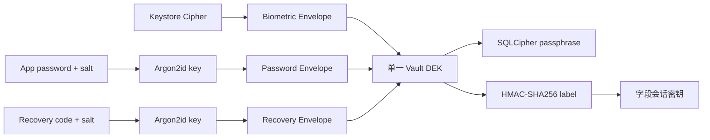

# 密钥管理

## 当前密钥体系

当前实现不是双 DEK。一个随机 256-bit Vault DEK 被多个认证 Envelope 包装；字段会话密钥使用固定域分离标签从
DEK 派生。该决策由 [ADR-0019](../../project/decisions/ADR-0019-single-dek-derived-session-key.md) 替代旧
ADR-0003。

## VaultBootstrapStore

Envelope 与 verification tag 必须在数据库打开前可用，因此保存于独立 VaultBootstrapStore。接口位于
Domain 的 `access.port`，生物识别轮换状态位于 `access.model`；当前 Proto DataStore 实现位于 Data 层。
Room schema 当前没有认证 Envelope 真相源；不得重新把认证材料写入业务数据库。

## 生命周期

1. 初始化生成 DEK、verification tag 和首个 Envelope。
2. 解锁时读取指定 Envelope，解封并验证 DEK。
3. `DekManager` 保存 DEK 的内存副本并派生会话密钥。
4. 添加认证方式只新增或替换 Envelope。
5. 锁定强度由 `VaultSessionController.lock(request)` 按 `request.reason` 映射。`USER` / `IDLE_TIMEOUT` 为 `SOFT_LOCKED`：撤销授权、调用数据库会话 `softLock()` 排空 lease，保持数据库打开和 DEK 缓存，只清除字段会话密钥；后续认证可复用 DEK 并重新打开会话。`AUTOFILL_REQUEST_FINISHED`、`BACKGROUND`、`RECOVERY_EXIT`、`INTEGRITY_FAILURE`、`APP_EXIT` 为 `SEALED`：撤销授权，调用 `sessionManager.seal()` 等待 lease 实际退出并关闭数据库，清除字段会话密钥后才调用 `DekManager.lock()` 覆盖 DEK。非合作 lease 不会因 `Job.cancel()` 或等待超时就被当作已退出；资源保持打开，锁定继续等待，验收记录见[Session 关闭与 DEK 擦除审查](../../project/reviews/2026-11-07-session-close-and-dek-wipe.md)。

当前应用没有删除完整 Vault 的操作。设置中的“永久重置”只删除 SQLCipher 数据库及托管附件/图片，随后用现有
Bootstrap DEK 打开空数据库；认证 Envelope、verification tag、生物识别绑定和 Autofill Inbox 的密钥材料及队列
均保留。该操作不等同于删除 Vault，也不清除 Inbox。完整行为见[数据库重置](../data/database.md#初始化失败与数据重置)
和[Sealed Inbox 生命周期](../../product/autofill/sealed-inbox.md#备份和生命周期)。

`SecretKeySpec.encoded` 可能返回副本，对它调用 `fill(0)` 不能证明内部密钥已被擦除。文档和注释只能表述为“尽力缩短并覆盖可控副本”。

## 参数与清理的已知边界

首次请求认证 KDF 参数时，`DeviceKdfConfiguration.selected()` 在 `Dispatchers.Default` 测量 Argon2id v1.3 基线：memory 为 65,536 KiB（64 MiB）、iterations 为 3、parallelism 为 4、输出为 256 bit。`DeviceKdfPolicy.select(heapMiB, processors, baselineMillis)` 只生成以下两类配置：当最大堆至少 384 MiB、处理器数至少 4 且基线不超过 150 ms 时，选择 131,072 KiB / 3 次；否则选择 65,536 KiB，并在基线不超过 250 ms 时用 4 次迭代，较慢时用 3 次。版本、内存、迭代、并行度和输出长度由 `initializeIfAbsent(candidate)` 写入 `bootstrap.pb`，并以 DataStore 的 first-writer-wins 结果为准。之后主密码及恢复码创建和验证只读取该配置，不在解锁时重新校准；加密备份仍使用其独立的 v1 头部参数。

`selected()` 在实例 Mutex 内先读配置；首次缺失时用固定非用户口令、随机 salt 和基线参数测量，覆盖校准缓冲，再由 `ProtoVaultBootstrapStore.initializeIfAbsent()` 在 DataStore 原子更新中写入字段 10。配置值域与选择器一致：Argon2id v1.3、64 MiB/3 次、64 MiB/4 次或 128 MiB/3 次，并行度 4、256-bit 输出。配置和认证信封共存于 `bootstrap.pb`；发现已有信封却没有配置时拒绝初始化，不猜测参数，也不删除数据。

主密码和恢复码的创建与验证都调用 `selected()`，显式把持久化参数传给 Argon2id。密码/恢复码信封使用稳定字节编码把信封类型、算法、格式版本、salt 和版本/m/t/p/输出长度绑定到 AES-GCM AAD；解封前先验证参数与结构，再执行 KDF。认证配置与信封是一个整体，不能只复制其中一部分。参数和 salt 是公开元数据，不依赖隐藏来保证安全。备份容器有独立的自描述头，导出显式采用容器基线参数，导入按已认证的头部参数派生。

进一步的设备资源与故障注入验证见[安全跟踪 Task 9](../../project/work/plans/2026-11-06-passly-security-scan-followups.md#task-9首次创建并固定设备-argon2id-参数)。

2026-11-07 已修复原缓存 DEK 在状态替换时失去引用的问题：`DekManager.lock()` 先保存 `previousState`，再发布
`DekState.Locking`，随后在 `NonCancellable` 区覆盖 `previousState.dek`、清除字段 key 并发布 `DekState.Locked`。
锁定期间日志/清理异常仍完成收尾并传播；回归测试持有原数组引用验证其内容归零，并覆盖取消与 fatal `Error`。
DEK 覆盖时序的验收证据与擦除限制见[Session 关闭与 DEK 擦除审查](../../project/reviews/2026-11-07-session-close-and-dek-wipe.md)。

## 代码位置

| 职责 | 类/函数 | 源码文件 |
| --- | --- | --- |
| 定义 bootstrap 数据边界 | `VaultBootstrapStore`、`ProtoVaultBootstrapStore` | [`VaultBootstrapStore.kt`](../../../domain/src/main/kotlin/com/aozijx/passly/domain/access/port/VaultBootstrapStore.kt)、[`ProtoVaultBootstrapStore.kt`](../../../data/src/main/java/com/aozijx/passly/data/local/datastore/ProtoVaultBootstrapStore.kt) |
| 定义并持久化认证 KDF 参数 | `AuthenticationKdfParameters`、`AuthenticationKdfConfigurationStore.load()`、`initializeIfAbsent(parameters)`、`ProtoVaultBootstrapStore.toProto()` / `toDomain()` | [`AuthenticationKdfParameters.kt`](../../../domain/src/main/kotlin/com/aozijx/passly/domain/access/model/AuthenticationKdfParameters.kt)、[`AuthenticationKdfConfigurationStore.kt`](../../../domain/src/main/kotlin/com/aozijx/passly/domain/access/port/AuthenticationKdfConfigurationStore.kt)、[`ProtoVaultBootstrapStore.kt`](../../../data/src/main/java/com/aozijx/passly/data/local/datastore/ProtoVaultBootstrapStore.kt)、[`bootstrap.proto`](../../../data/src/main/proto/bootstrap.proto) |
| 校准设备、选择并读取已持久化参数 | `DeviceKdfConfiguration.selected()`、`calibrate()`、`DeviceKdfPolicy.select(heapMiB, processors, baselineMillis)` | [`DeviceKdfConfiguration.kt`](../../../security/src/main/java/com/aozijx/passly/security/authentication/method/credential/DeviceKdfConfiguration.kt) |
| 创建与验证应用密码/恢复码时将参数传入 KDF | `DefaultAuthenticationMethodProvisioner.setAppPassword()` / `checkRecoveryCode()`、`DefaultRecoveryCodeDraftFactory.generate()`、`CredentialMethodExecutor.execute()` | [`DefaultAuthenticationMethodProvisioner.kt`](../../../security/src/main/java/com/aozijx/passly/security/authentication/method/credential/DefaultAuthenticationMethodProvisioner.kt)、[`DefaultRecoveryCodeDraftFactory.kt`](../../../security/src/main/java/com/aozijx/passly/security/authentication/method/credential/DefaultRecoveryCodeDraftFactory.kt)、[`CredentialMethodExecutor.kt`](../../../security/src/main/java/com/aozijx/passly/security/authentication/method/credential/CredentialMethodExecutor.kt) |
| 管理 DEK 与派生字段密钥 | `DekManager`、`SecuritySensitiveFieldCryptor` | [`DekManager.kt`](../../../security/src/main/java/com/aozijx/passly/security/dek/DekManager.kt)、[`SecuritySensitiveFieldCryptor.kt`](../../../security/src/main/java/com/aozijx/passly/security/dek/SecuritySensitiveFieldCryptor.kt) |
| 封装并恢复 DEK envelope | `EnvelopeManager` | [`EnvelopeManager.kt`](../../../security/src/main/java/com/aozijx/passly/security/envelope/EnvelopeManager.kt) |
| 按锁定原因选择软锁/封存并收尾密钥 | `VaultSessionController.lock(request)`、`LockReason.toLockLevel()`、`sealDatabaseForLock(...)`、`clearSensitiveDataKeys()`、`DekManager.lock()` | [`VaultSessionController.kt`](../../../security/src/main/java/com/aozijx/passly/security/session/VaultSessionController.kt)、[`DekManager.kt`](../../../security/src/main/java/com/aozijx/passly/security/dek/DekManager.kt) |
