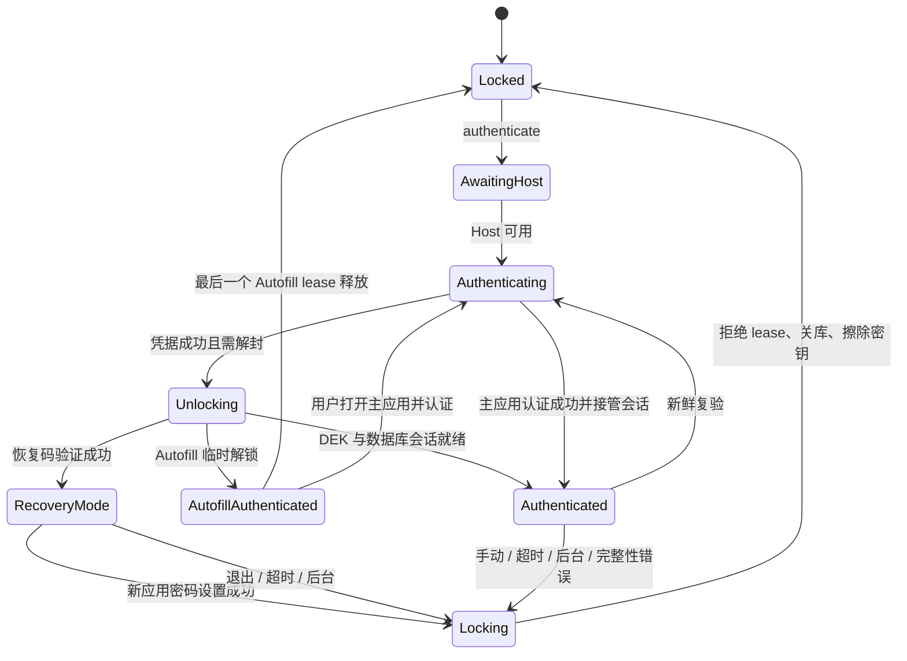
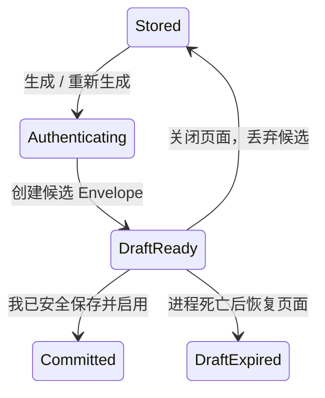

# 统一认证与恢复码

状态：当前实现。

代码核对日期：2026-10-29。

## 契约与状态机

`AuthenticationManager` 是唯一认证编排入口。请求只包含目的、允许方式和 `AuthenticationRequestId`；不得携带
Activity、文案、资源 ID、Launcher、Cipher 或 PendingIntent。

同一时间只允许一个活跃请求。`Authenticated` 表示主应用完整会话；`AutofillAuthenticated` 只允许 Autofill
候选、单条秘密读取、使用记录和已确认的凭据保存，不会挂载主 Vault。普通解锁只复用 `Authenticated`；Autofill
可以复用这两种已打开会话。`Locking` 即使底层存储尚未封存也不得复用。主应用在 Autofill 临时会话上认证成功后会
把会话提升为 `Authenticated`，之后延迟到达的 Autofill 释放不能再锁掉该会话。复验、安全设置、备份和诊断导出必须重新认证。用户主动取消
返回 `Cancelled(byUser = true)` 且不显示错误；其他情况由认证中心返回结构化 `AuthenticationFailure`
。调用方只能
转发失败，不能重新判断认证结果；页面按失败码和发起认证的方式生成本地化反馈。

前台用户交互会重新开始空闲计时。进程进入后台后停止前台空闲计时；启用“后台自动锁定”时，从进入后台开始按同一个
自动锁定时间倒计时，倒计时内返回前台会取消后台封存。倒计时已经到期并开始封存后，返回前台不得取消正在进行的
关库和密钥擦除。恢复模式退出、屏幕关闭、翻转、用户主动锁定、Autofill 临时会话释放及完整性失败仍按各自策略立即处理。
系统文件选择器、分享页和 Autofill 认证 Activity 导致的短暂前后台切换因此不会立即截断已授权操作。

## Host 与生物识别

Main、Autofill Fill 和 Credential Response Activity 都在根 Compose 安装 `AuthenticationHost`。Registry 只保存 Host
弱引用、owner ID 和注册 token；取得 lease 与实际展示前都会检查 resumed、finishing、destroyed 和 token。无 Host
时最多等待 500 ms，Activity 销毁会取消所属请求，Autofill 请求不会转交 MainActivity。

Legacy 锁定保存不再启动保存 Activity 或创建认证 interaction，而是写入密封 Inbox；完整 Vault 解锁后才解密并写入 Entry。
保存处理与填充结果的临时 lease 生命周期相互独立；已存在的完整 `Authenticated` 会话不受影响。

PromptInfo 与 CryptoObject 分离。Enroll/Rotate 使用新的 ENCRYPT Cipher，Unlock 使用最新 alias 和 Envelope nonce
创建新的 DECRYPT Cipher，VerifyIdentity 不携带 CryptoObject。Cipher 不缓存，也不进入 Bundle、Intent、
SavedStateHandle 或 PendingIntent。`KeyMissing`、`KeyInvalidated`、`CryptoObjectInvalid` 和 `HostUnavailable` 分别映射。

## KDF 与敏感内存

应用密码和恢复码的 Argon2id 只在专用单线程 `KdfRunner` 上执行。取消会立即结束调用方等待，但 Native worker
可能继续；worker 返回后检查 request token，已取消的结果只擦除、不提交。密码副本、派生 key 和未交接 DEK 由拥有者
在同步 `finally` 中尽力覆盖，正常状态与 callback 在 Main.immediate 串行提交。

应用密码和恢复码的连续错误次数由认证中心记录。当前策略是每种凭据方式最多连续错误 5 次；第 5 次起返回
`RATE_LIMITED`，30 秒后允许再次尝试。成功认证会清除该方式的计数。计数只保存在进程内存中，不写入
DataStore、数据库或日志；页面只展示 `AuthenticationFailure` 中的剩余次数或等待时间，不能自行判断密码是否正确。

## 恢复码草稿

- 旧 Recovery Envelope 在用户确认前保持有效；确认提交后旧码才失效。
- 可提交草稿由 Activity-retained `RecoveryCodeDraft` 持有；展示期间 presentation 只在
  `RecoveryCodeDraftUiState.Ready` 分支持有独立的可擦除 disclosure。该副本不进入 SavedStateHandle、
  Bundle 或磁盘，并在关闭、提交、替换及 ViewModel 清理时擦除。
- SavedStateHandle 只保存 disclosure 标记和 generation ID。进程恢复但草稿不存在时显示
  “恢复码草稿已过期，请重新认证后生成”。
- 恢复码不再产生普通 `Authenticated` 会话。验证成功后进入受限 `RecoveryMode`：数据库可以为恢复任务打开，
  但 `VaultAccessState.isAuthorized` 仍为 false，主 Vault、详情、查看和复制密码都不能挂载。
- 恢复模式只允许设置新的应用密码、重新配置生物识别、`RECOVERY_EXPORT` 和退出锁定。设置新应用密码后立即以
  `RECOVERY_EXIT` 锁定，用户必须用新密码重新进入普通完整会话。
- `RECOVERY_EXPORT` 只接受恢复码，并且只能输出要求新备份密码的 Passly 加密格式；恢复码不作为备份密码，也不能
  放宽普通 `BACKUP_EXPORT`。
- 不存在“查看已有恢复码”。

## 认证目的边界

| 目的                              | 生物识别 / 应用密码 | 恢复码                             |
|---------------------------------|-------------|---------------------------------|
| `UNLOCK_VAULT`                  | 允许          | 拒绝；恢复码改走 `RECOVER_AUTH_METHODS` |
| `AUTOFILL`                      | 允许；只建立 Autofill 临时会话 | 拒绝                              |
| `REVEAL_SECRET` / `COPY_SECRET` | 允许          | 拒绝                              |
| `BACKUP_EXPORT`                 | 允许          | 拒绝                              |
| `RECOVERY_EXPORT`               | 拒绝          | 允许，仅恢复模式内的加密导出                  |
| `RECOVER_AUTH_METHODS`          | 拒绝          | 允许                              |
| `CLEAR_DATABASE`                | 允许          | 拒绝                              |

`AuthenticationRequest.allowedMethods` 只能继续缩小上表，不能扩大。最终交集由认证中心的
`allowedAuthenticationMethods` 计算，页面和 ViewModel 不复制认证方式映射。

## 生物识别策略轮换

`BiometricConfigurationSource` 从 bootstrap 的已提交 binding 投影配置，过滤重复配置；candidate、journal 和清理列表
不改变策略真相。页面独立订阅该流，策略改变即使没有认证方式集合变化也会刷新。配置清除后不再显示为已启用。
轮换仅提交 bootstrap，不另外写 security preferences。启用时读取当前配置，替换密钥沿用已提交策略；
尚未配置过密钥时，Domain 明确选择“录入变更使密钥失效”作为首次创建策略，不将偏好默认值当作已有密钥状态。

安全设置保留 `AuthenticationResult` 的成功、取消和失败语义，不再用 `NOT_APPLIED` 合并原因。
`SecuritySettingsViewModel` 在调度前占用单次认证操作状态，生物识别开关与策略切换互斥；
执行期间两个开关禁用，取消或失败后允许重试。页面销毁后不恢复可操作状态，也不发布迟到反馈。
策略入口只接受已加载且已启用生物识别的状态，不能经由隐藏动作意外启用认证方式。
成功与用户取消保持静默；失败发布本地化资源键，保留“至少一种解锁方式”和会话受限的具体提示。
仓库 Flow 与认证能力 Flow 继续决定实际选择；锁定超时和后台锁定偏好共用保存失败处理，
Route 在 STARTED 生命周期消费错误并按当前语言解析，不展示内部异常文本。

Bootstrap 先写 PREPARED journal，再创建 candidate key/Envelope；单次更新切换 active binding 并登记旧 alias
待清理。提交后删除旧 alias 失败只记录并留待 Reconciler 重试，不回滚新 binding。启动和认证成功后都会清理 orphan
candidate 与 obsolete alias。

同一 `RotateBiometricKeyUseCase` 串行执行轮换，避免共享 journal 被并发候选覆盖。
`withBiometricRotationCandidate` 在正常结果、异常和协程取消退出时统一清理，清理在 `NonCancellable` 中执行。
它先重新读取当前 binding：已原子提交的 candidate 不可删除；未提交的 candidate 删除成功后才清除本次 journal。
删除失败保留 journal 供 Reconciler 重试，过期清理不能清除其他 candidate 的 journal；清理异常不能替换原始失败或取消。
Android 密钥创建将实际策略传入 `setInvalidatedByBiometricEnrollment`；此标志由 Keystore 执行，代码检查和模拟器测试
不等于已在实体设备完成生物识别录入变更验收。

## 安全会话可观测性

认证、锁定和数据库会话统一使用结构化 Logger。一次认证或锁定操作创建一个根 trace；该操作触发的数据库打开、恢复、
软锁、租约排干和封存事件在当前 trace 内创建子 span，不再为每条事件生成新的关联 ID。数据库运行时模块只发布
平台无关的 `SessionTransitionEvent`，由 data 层适配为日志，避免运行时会话依赖 Android 或日志实现。

数据库会话转换记录 `from_state`、`to_state`、`owner`、`reason`、`lock_type`、`elapsed_ms`；租约排干超时还记录
`timeout_ms` 和 `active_lease_count`。锁定开始与完成记录 `lock_reason`、`trigger`、`timeout_ms`、`result` 和
`elapsed_ms`。认证完成只记录受控枚举 `BIOMETRIC`、`MASTER_PASSWORD` 或 `RECOVERY`，不记录凭据、异常消息、
明文包名或请求携带的敏感内容。

底层抛出的异常与清理阶段捕获的异常都以 ERROR 和标准错误码记录安全异常快照；清理阶段的日志不能改变原有控制流，
数据库关闭失败后仍继续擦除密钥并发布 Locked。业务拒绝属于 WARN 降级，尚未到期或因返回前台取消的后台倒计时不是锁库失败。
锁定取得互斥权并开始状态转换后，撤权、清除敏感字段密钥、软锁/封存和擦除 DEK 在 `NonCancellable` 区完成；调用方取消或软锁/封存操作抛出取消异常时，都会在终态发布后继续传播并记录为 `LockCancelled`，不会记成锁定失败。尚在等待互斥权时被取消的请求不会启动锁定。
`AutofillAuthenticated` 的临时会话所有权不变：必须先向平台交付填充结果，再释放 Autofill interaction 并触发封存；
普通 `Authenticated` 会话不会被延迟到达的 Autofill 释放关闭。
