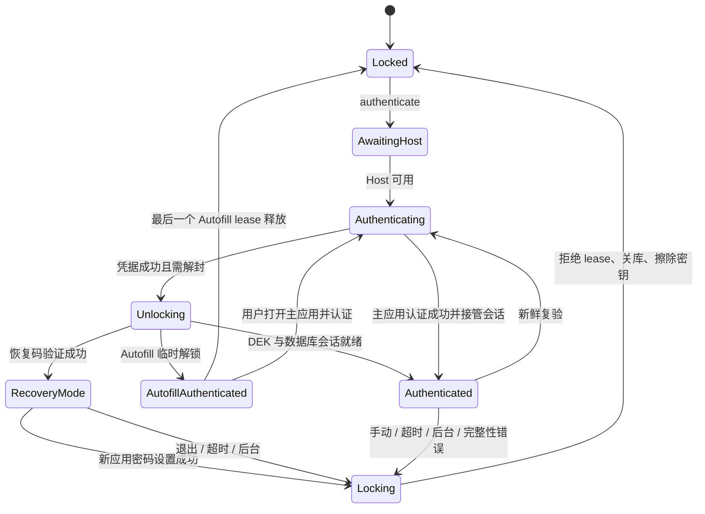
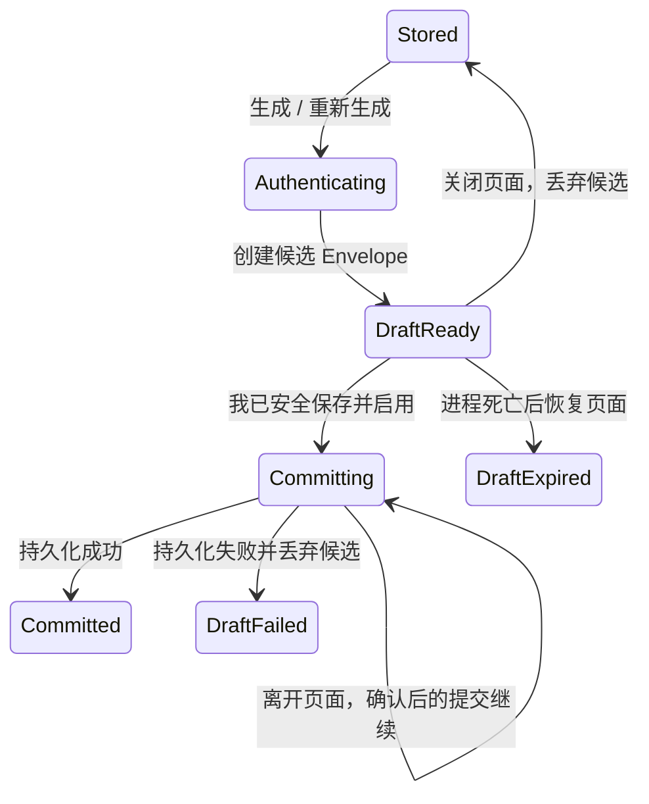

# 统一认证与恢复码

状态：当前实现。

代码核对日期：2026-11-02。

## 契约与状态机

`AuthenticationManager` 是唯一认证编排入口。请求只包含目的、允许方式和 `AuthenticationRequestId`；不得携带
Activity、文案、资源 ID、Launcher、Cipher 或 PendingIntent。

同一时间只允许一个活跃请求。`Authenticated` 表示主应用完整会话；`AutofillAuthenticated` 只允许 Autofill
候选、单条秘密读取、使用记录和已确认的凭据保存，不会挂载主 Vault。普通解锁只复用 `Authenticated`；Autofill
可以复用这两种已打开会话。`Locking` 即使底层存储尚未封存也不得复用。主应用在 Autofill 临时会话上认证成功后会
把会话提升为 `Authenticated`，之后延迟到达的 Autofill 释放不能再锁掉该会话。复验、安全设置、备份和诊断导出必须重新认证。用户主动取消
返回 `Cancelled(byUser = true)` 且不显示错误；其他情况由认证中心返回结构化 `AuthenticationFailure`
。调用方只能
转发失败，不能重新判断认证结果；页面按失败码和发起认证的方式生成本地化反馈。

认证入口先消费凭据，再执行 trace 和请求 slot；无论会话复用、业务拒绝、忙、取消、恢复失败还是 executor 返回，最外层 `finally` 都会擦除提交的凭据缓冲区。请求槽在 `finally` 释放后才允许下一次尝试。认证过程中的普通
`Exception` 会先尝试记录和恢复原 session state，再映射为 `SESSION_TRANSITION_FAILED`；取消会在
`NonCancellable` 中完成 session 恢复后继续传播，JVM fatal `Error` 完成必要恢复后原样传播。恢复或错误遥测产生的次级异常
保留为 suppressed；次级 fatal/cancellation 可取代普通异常，但不能覆盖已经发生的 fatal 或调用方取消。认证终态日志失败
也作为次级异常保留，不能遮蔽原认证错误。恢复码 envelope 删除失败会回滚暂存 session；fatal 删除/回滚错误按同一优先级传播。

前台用户交互会重新开始空闲计时。进程进入后台后停止前台空闲计时；启用“后台自动锁定”时，从进入后台开始按同一个
自动锁定时间倒计时，倒计时内返回前台会取消后台封存。倒计时已经到期并开始封存后，返回前台不得取消正在进行的
关库和密钥擦除。恢复模式退出、屏幕关闭、翻转、用户主动锁定、Autofill 临时会话释放及完整性失败仍按各自策略立即处理。
系统文件选择器、分享页和 Autofill 认证 Activity 导致的短暂前后台切换因此不会立即截断已授权操作。

设备翻转锁定后的可选“退出并清理 task”仅在 flip-to-lock 和清理设置都开启、且翻转成功锁定会话时触发；屏幕关闭锁定永不清理 task。进程级协调器保留一个尚未消费的请求，由当前 resumed 的 Main、Credential Manager、Legacy Autofill 或 Accessibility Autofill Activity 认领。Activity 暂停或重建会释放认领，替代 Activity 可继续处理该请求；无 resumed Activity 时请求只保留在进程内。收到请求后显示关闭提醒并等待 1 秒，真正执行前再次核对请求、Activity owner 和 Locked 状态。`Authenticated` 或 `AutofillAuthenticated` 会撤销请求和延迟关闭；认证失败或取消并回到 Locked 时，仍 pending 的请求会恢复处理；进程死亡后不会恢复旧请求。

## Host 与生物识别

认证方式可用性从 `VaultBootstrapStore` 一次读取 `AuthenticationCredentialSnapshot`。DataStore adapter 在同一份 Bootstrap
值中投影 biometric envelope/binding、应用密码与恢复码是否配置；BiometricManager 的硬件能力在该持久快照之外单独判断。
`AuthenticationMethodsState` 为每次可用性刷新分配 generation 并串行执行解析；较新的刷新会使较旧的在途结果失效，之后重新读取持久状态。恢复码提交消费也会使旧快照失效，不能重新发布已消费的方式。Manager 的长期 scope 托管刷新 job：调用方取消会立即收到取消，但不会取消已发起的最新状态同步；Mutex 释放后队列中的刷新继续执行。后台解析失败在独立 trace span 中使用结构化 `VaultOperationFailed` 日志记录；可恢复异常记为 WARN 降级，fatal `Error` 记为 ERROR。普通观察器异常作为 suppressed 信息保留，观察器抛取消或 fatal Error 时优先传播该异常，并将原解析错误保留为 suppressed。

Main、Autofill Fill 和 Credential Response Activity 都在根 Compose 安装 `AuthenticationHost`。Registry 只保存 Host
弱引用、owner ID 和注册 token；取得 lease 与实际展示前都会检查 resumed、finishing、destroyed 和 token。无 Host
时最多等待 500 ms，Activity 销毁会取消所属请求，Autofill 请求不会转交 MainActivity。
密码 dialog 回调交付一次性 `CharArray`：活跃的 Secret 请求通过 `SecretChars.take()` 接管并清零源数组；请求已取消、dialog 已离开 Secret 状态或 owner 已清除时，宿主直接擦除迟到输入，不保留到下一次请求。
`AuthenticationHostRegistry` 的 `HostLease` 同时独占 Activity 的认证 UI 流程；普通认证与生物识别策略轮换共用该租约，取消、Host 不可用或流程结束都会在 owner 的 `finally` 中释放。等待租约可取消，活动 dialog/biometric prompt 未结束时不会启动第二个 UI 流程。
每个方法选择、密码 dialog 与 biometric prompt 都带独立请求 identity。Compose 事件返回创建它的 identity；迟到事件不会完成新 continuation，密码输入在 identity 失配时擦除。Prompt 与它的 continuation 由同一个请求 owner 持有；Host 销毁会取消当前 continuation 并关闭对应 prompt，旧回调只可清理自己的请求。Prompt 启动与取消在 owner 上串行化，避免取消已生效后又启动认证。

Legacy 锁定保存不再启动保存 Activity 或创建认证 interaction，而是写入密封 Inbox；完整 Vault 解锁后才解密并写入 Entry。
保存处理与填充结果的临时 lease 生命周期相互独立；已存在的完整 `Authenticated` 会话不受影响。

PromptInfo 与 CryptoObject 分离。Enroll/Rotate 使用新的 ENCRYPT Cipher，Unlock 使用最新 alias 和 Envelope nonce
创建新的 DECRYPT Cipher，VerifyIdentity 不携带 CryptoObject。Cipher 不缓存，也不进入 Bundle、Intent、
SavedStateHandle 或 PendingIntent。`KeyMissing`、`KeyInvalidated`、`CryptoObjectInvalid` 和 `HostUnavailable` 分别映射。

## KDF 与敏感内存

应用密码和恢复码的 Argon2id 只在专用单线程 `KdfRunner` 上执行。取消会立即结束调用方等待，但 Native worker
可能继续；worker 返回后检查 request token，已取消的结果只擦除、不提交。密码副本、派生 key 和未交接 DEK 由拥有者
在同步 `finally` 中尽力覆盖，正常状态与 callback 在 Main.immediate 串行提交。解锁期间若取消发生在新 DEK 暂存后，
会在 `NonCancellable` 中封存数据库、擦除 DEK 并发布 `Locked`，然后继续传播取消；已有 DEK 的软锁恢复取消时保留
DEK，并按数据库会话实际状态恢复锁级别。恢复模式解锁取消会封存会话并擦除暂存 DEK。

设置应用密码以持久化的新 Envelope 为提交点。若后续可用性刷新或会话发布抛普通异常，provisioner 会在
`NonCancellable` 中读取持久 envelope，并用本次随机 salt 确认写入；已提交时结果仍表示应用密码已设置，避免引导用户
重复提交。未发现本次 envelope 时才返回设置失败；取消继续传播，fatal `Error` 不映射成业务失败。密码、salt、派生 key
分别由 `SecretChars`、`finally` 和 `OwnedBytes.use` 清理。恢复码草稿在 `VaultBootstrapStore.save()` 成功后即已提交；若
store 在写入后抛错，会读回并比较完整 envelope。`RecoveryCredentialDraft.isCommitted` 供页面在提交取消或抛错后读取该
提交事实：已提交则更新可用状态并移除 disclosure，未提交且取消则恢复可重试 disclosure。生成和 commit 只将普通
`Exception` 映射为业务失败；取消仍传播，fatal `Error` 在草稿密钥与明文清理后传播。

安全设置中的应用密码设置、修改和禁用共享一个进行中操作状态。提交后确认、取消和输入控件禁用，ViewModel 同步拒绝重复请求；
请求字符数组由 Interactor 的 `finally` 清理，若页面 owner 已退出、请求被拒绝或 ViewModel 在协程启动前销毁，ViewModel 也会清理。
页面退出使当前结果 owner 失效，但不会主动取消已启动的操作；旧结果不会投递给之后重新进入的页面。
若 ViewModel 被销毁，操作协程会取消并执行请求缓冲区清理。

Security Route 每次离开 Composition 都会清空应用密码设置/修改对话框的当前、新密码和确认输入，并关闭活动对话框；Activity 配置重建也会走此清理，重建后的 Route 从空草稿开始。Coordinator 用可擦除 `CharArray` 保存其所有草稿，字段替换、提交、关闭和 Route dispose 会覆盖其拥有的数组；提交时另建请求副本并立即清理 Coordinator 草稿，ViewModel/Interactor 仍各自负责已提交请求缓冲区的最终清理。Compose 文本输入 API 和渲染模型仍使用 `String`，其不可变副本只能等待回收，因此这项清理不代表 JVM/Compose 内存已完全擦除。

应用密码和恢复码的连续错误次数由认证中心记录。当前策略是每种凭据方式最多连续错误 5 次；第 5 次起返回
`RATE_LIMITED`，30 秒后允许再次尝试。成功认证会清除该方式的计数。计数只保存在进程内存中，不写入
DataStore、数据库或日志；页面只展示 `AuthenticationFailure` 中的剩余次数或等待时间，不能自行判断密码是否正确。

## 恢复码草稿

- 旧 Recovery Envelope 在用户确认前保持有效；确认提交后旧码才失效。
- 可提交草稿由 Activity-retained `RecoveryCodeDraft` 持有；展示期间 presentation 只在
  `RecoveryCodeDraftUiState.Ready` 分支持有独立的可擦除 disclosure。该副本不进入 SavedStateHandle、
  Bundle 或磁盘，并在关闭、提交进入终态、替换及 ViewModel 清理时擦除。页面离开时关闭 Ready 草稿、擦除
  presentation disclosure 并移除 SavedStateHandle 标记；若用户已确认并进入 Committing，Domain 提交由仍存活的
  ViewModel scope 收尾，页面 state 只保留不含 disclosure 的 Committing 标记，完成后不把旧页面结果重新展示。
- 确认操作会在启动协程前同步占用 `Committing` 状态，重复确认不会再次提交。提交期间页面保留同一 disclosure，
  禁用复制、确认和丢弃，并忽略弹层关闭；成功进入 `Committed` 并更新恢复码可用状态，失败则丢弃候选并进入 `Failed`。
- SavedStateHandle 只保存 disclosure 标记和 generation ID。进程恢复但草稿不存在时显示
  “恢复码草稿已过期，请重新认证后生成”。
- 恢复码不再产生普通 `Authenticated` 会话。验证成功后进入受限 `RecoveryMode`：数据库可以为恢复任务打开，
  但 `VaultAccessState.isAuthorized` 仍为 false，主 Vault、详情、查看和复制密码都不能挂载。
- 恢复码草稿复制绑定仍然活动的草稿；关闭或替换草稿期间，剪贴板保留策略读取完成后会重新核对所有权，不会复制旧草稿。
- 设置页验证已有恢复码时，输入框在检查期间禁用；ViewModel 也拒绝迟到的输入事件。验证请求绑定页面 owner，页面离开时
  取消请求、擦除原始 `OwnedChars` 和验证用 `CharArray` 并重置输入；若认证端口迟到返回，owner/request 检查会丢弃结果，
  不会覆盖新页面状态。
- 恢复模式只允许设置新的应用密码、重新配置生物识别、`RECOVERY_EXPORT` 和退出锁定。设置新应用密码后立即以
  `RECOVERY_EXIT` 锁定，用户必须用新密码重新进入普通完整会话。
- `RECOVERY_EXPORT` 只接受恢复码，并且只能输出要求新备份密码的 Passly 加密格式；恢复码不作为备份密码，也不能
  放宽普通 `BACKUP_EXPORT`。
- 不存在“查看已有恢复码”。

## 认证目的边界

| 目的                              | 生物识别 / 应用密码 | 恢复码                             |
|---------------------------------|-------------|---------------------------------|
| `UNLOCK_VAULT`                  | 允许          | 拒绝；恢复码改走 `RECOVER_AUTH_METHODS` |
| `AUTOFILL`                      | 允许；只建立 Autofill 临时会话 | 拒绝                              |
| `REVEAL_SECRET` / `COPY_SECRET` | 允许          | 拒绝                              |
| `BACKUP_EXPORT`                 | 允许          | 拒绝                              |
| `RECOVERY_EXPORT`               | 拒绝          | 允许，仅恢复模式内的加密导出                  |
| `RECOVER_AUTH_METHODS`          | 拒绝          | 允许                              |
| `CLEAR_DATABASE`                | 允许          | 拒绝                              |

`AuthenticationRequest.allowedMethods` 只能继续缩小上表，不能扩大。最终交集由认证中心的
`allowedAuthenticationMethods` 计算，页面和 ViewModel 不复制认证方式映射。

## 生物识别策略轮换

`BiometricConfigurationSource` 从 bootstrap 的已提交 binding 投影配置，过滤重复配置；candidate、journal 和清理列表
不改变策略真相。页面独立订阅该流，策略改变即使没有认证方式集合变化也会刷新。配置清除后不再显示为已启用。
轮换仅提交 bootstrap，不另外写 security preferences。启用时读取当前配置，替换密钥沿用已提交策略；
尚未配置过密钥时，Domain 明确选择“录入变更使密钥失效”作为首次创建策略，不将偏好默认值当作已有密钥状态。

安全设置保留 `AuthenticationResult` 的成功、取消和失败语义，不再用 `NOT_APPLIED` 合并原因。
`SecuritySettingsViewModel` 在调度前占用单次认证操作状态，生物识别开关与策略切换互斥；
执行期间两个开关禁用，取消或失败后允许重试。页面销毁后不恢复可操作状态，也不发布迟到反馈。
策略入口只接受已加载且已启用生物识别的状态，不能经由隐藏动作意外启用认证方式。
成功与用户取消保持静默；失败发布本地化资源键，保留“至少一种解锁方式”和会话受限的具体提示。
仓库 Flow 与认证能力 Flow 继续决定实际选择；锁定超时和后台锁定偏好共用保存失败处理，
Route 在 STARTED 生命周期消费错误并按当前语言解析，不展示内部异常文本。

Bootstrap 先写 PREPARED journal，再创建 candidate key/Envelope；单次更新切换 active binding 并登记旧 alias
待清理，该原子更新是 durable commit point。之后旧 alias 删除或 journal 清理失败不会回滚新 binding；调用结果仍为
BIOMETRIC `Success`，并带 `BIOMETRIC_ROTATION_CLEANUP` pending-maintenance 标记。安全设置提示用户新策略已生效、旧密钥清理将重试，认证可用性按成功结果刷新。
提交后的可恢复 cleanup 在 `NonCancellable` 中尝试；取消和 fatal `Error` 仍传播。

同一 `RotateBiometricKeyUseCase` 串行执行轮换，避免共享 journal 被并发候选覆盖。
`withBiometricRotationCandidate` 在正常结果、异常和协程取消退出时统一清理，清理在 `NonCancellable` 中执行。
它先重新读取当前 binding：已原子提交的 candidate 不可删除；未提交的 candidate 删除成功后才清除本次 journal。
删除失败保留 journal 供 Reconciler 重试，过期清理不能清除其他 candidate 的 journal；清理异常不能替换原始失败或取消，清理阶段的 fatal `Error` 优先传播。
`BiometricRotationReconciler` 串行处理 PREPARED/COMMITTED journal 和 cleanup alias。普通 DataStore/Keystore 异常与删除返回失败会记录结构化 deferred-cleanup 事件并返回 `RETRY_REQUIRED`，持久标记保留；取消和 fatal `Error` 继续传播。应用启动由 Reconciler 自己拥有可恢复失败处理，不会让普通异常成为未处理的 application-scope 异常。
轮换前也会触发同一 Reconciler；若旧 journal/alias 仍无法清理，则拒绝开始另一笔轮换，避免覆盖单槽 rotation journal。已提交 active binding 可继续用于解锁；用户之后再次进行认证策略变更时会明确重试对账。
Android 密钥创建将实际策略传入 `setInvalidatedByBiometricEnrollment`；此标志由 Keystore 执行，代码检查和模拟器测试
不等于已在实体设备完成生物识别录入变更验收。

## 安全会话可观测性

数据库重置通过 security-owned 会话协调器与锁定、解锁和数据库恢复共用同一互斥边界。重置期间不授予完整会话访问；
数据库成功重开后恢复当前认证状态。若重开失败，访问状态转为 Locked 并发布可重试的数据库失败状态，保留恢复所需的
DEK；显式重试成功后再恢复 Authenticated。Data 查询订阅同时检查认证授权与数据库会话状态，封存期间停止读取，重开后恢复。

认证、锁定和数据库会话统一使用结构化 Logger。一次认证或锁定操作创建一个根 trace；该操作触发的数据库打开、恢复、
软锁、租约排干和封存事件在当前 trace 内创建子 span，不再为每条事件生成新的关联 ID。数据库运行时模块只发布
平台无关的 `SessionTransitionEvent`，由 data 层适配为日志，避免运行时会话依赖 Android 或日志实现。

数据库会话转换记录 `from_state`、`to_state`、`owner`、`reason`、`lock_type`、`elapsed_ms`；租约排干超时还记录
`timeout_ms` 和 `active_lease_count`。锁定开始与完成记录 `lock_reason`、`trigger`、`timeout_ms`、`result` 和
`elapsed_ms`。认证完成只记录受控枚举 `BIOMETRIC`、`MASTER_PASSWORD` 或 `RECOVERY`，不记录凭据、异常消息、
明文包名或请求携带的敏感内容。

底层抛出的异常与清理阶段捕获的异常都以 ERROR 和标准错误码记录安全异常快照；清理阶段的日志不能改变原有控制流，
数据库关闭失败后仍继续擦除密钥并发布 Locked。业务拒绝属于 WARN 降级，尚未到期或因返回前台取消的后台倒计时不是锁库失败。
锁定取得互斥权并开始状态转换后，撤权、清除敏感字段密钥、软锁/封存和擦除 DEK 在 `NonCancellable` 区完成；调用方取消或软锁/封存操作抛出取消异常时，都会在终态发布后继续传播并记录为 `LockCancelled`，不会记成锁定失败。尚在等待互斥权时被取消的请求不会启动锁定。
`AutofillAuthenticated` 的临时会话所有权不变：必须先向平台交付填充结果，再释放 Autofill interaction 并触发封存；
普通 `Authenticated` 会话不会被延迟到达的 Autofill 释放关闭。

## 代码位置

| 职责 | 类/函数 | 源码文件 |
| --- | --- | --- |
| 协调认证请求和认证方式 | `DefaultAuthenticationManager` | [`DefaultAuthenticationManager.kt`](../../security/src/main/java/com/aozijx/passly/security/authentication/DefaultAuthenticationManager.kt) |
| 管理应用密码设置请求与页面结果归属 | `AppPasswordSettingsViewModel.runChange()`、`AppPasswordSettingsInteractor.execute()` | [`AppPasswordSettingsViewModel.kt`](../../app/src/main/java/com/aozijx/passly/feature/settings/presentation/security/AppPasswordSettingsViewModel.kt)、[`AppPasswordSettingsInteractor.kt`](../../app/src/main/java/com/aozijx/passly/feature/settings/security/AppPasswordSettingsInteractor.kt) |
| 决定翻转锁定后的 task-clear 条件、请求所有者和一次性消费 | `DeviceLockHandler`、`ActiveTaskClearRequests`、`TaskClearActivityOwner` | [`DeviceLockController.kt`](../../app/src/main/java/com/aozijx/passly/app/DeviceLockController.kt)、[`ActiveTaskClearRequests.kt`](../../app/src/main/java/com/aozijx/passly/app/ActiveTaskClearRequests.kt)、[`TaskClearActivityOwner.kt`](../../app/src/main/java/com/aozijx/passly/app/TaskClearActivityOwner.kt) |
| 提供 Activity 认证宿主和生命周期租约 | `AuthenticationHost`、`AuthenticationHostRegistry` | [`AuthenticationHost.kt`](../../security/src/main/java/com/aozijx/passly/security/authentication/host/AuthenticationHost.kt)、[`AuthenticationHostRegistry.kt`](../../security/src/main/java/com/aozijx/passly/security/authentication/host/AuthenticationHostRegistry.kt) |
| 派生和封存 Vault 会话密钥 | `DekManager`、`VaultSessionController` | [`DekManager.kt`](../../core/src/main/kotlin/com/aozijx/passly/security/dek/DekManager.kt)、[`VaultSessionController.kt`](../../security/src/main/java/com/aozijx/passly/security/authentication/VaultSessionController.kt) |
| 区分应用密码 Envelope 提交与会话协调结果 | `runAppPasswordProvisioning()`、`DefaultAuthenticationMethodProvisioner.setAppPassword()` | [`AppPasswordProvisioningCommit.kt`](../../security/src/main/java/com/aozijx/passly/security/authentication/AppPasswordProvisioningCommit.kt)、[`DefaultAuthenticationMethodProvisioner.kt`](../../security/src/main/java/com/aozijx/passly/security/authentication/DefaultAuthenticationMethodProvisioner.kt) |
| 生成并提交 Recovery Code 草稿 | `DefaultRecoveryCredentialGenerator`、`SecureRecoveryCodeDraft`、`RecoveryCodeDraftInteractor`、`RecoveryCodeSettingsViewModel` | [`DefaultRecoveryCodeDraftFactory.kt`](../../security/src/main/java/com/aozijx/passly/security/authentication/DefaultRecoveryCodeDraftFactory.kt)、[`RecoveryCodeDraftInteractor.kt`](../../app/src/main/java/com/aozijx/passly/feature/settings/security/RecoveryCodeDraftInteractor.kt)、[`RecoveryCodeSettingsViewModel.kt`](../../app/src/main/java/com/aozijx/passly/feature/settings/presentation/security/RecoveryCodeSettingsViewModel.kt) |
| 执行生物识别密钥轮换 | `RotateBiometricKeyUseCase`、`BiometricCryptoFactory` | [`RotateBiometricKeyUseCase.kt`](../../security/src/main/java/com/aozijx/passly/security/authentication/RotateBiometricKeyUseCase.kt)、[`BiometricCryptoFactory.kt`](../../security/src/main/java/com/aozijx/passly/security/authentication/BiometricCryptoFactory.kt) |
