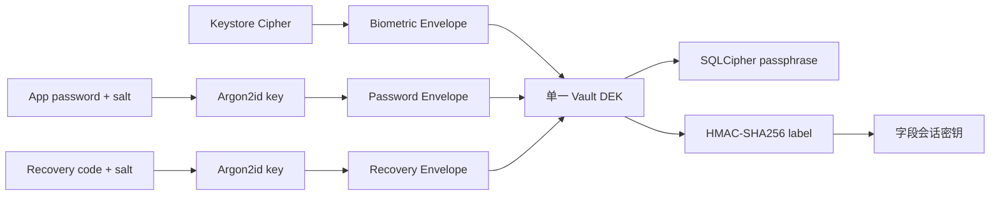

# 密钥管理

## 当前密钥体系

当前实现不是双 DEK。一个随机 256-bit Vault DEK 被多个认证 Envelope 包装；字段会话密钥使用固定域分离标签从
DEK 派生。该决策由 [ADR-0019](../decisions/ADR-0019-single-dek-derived-session-key.md) 替代旧
ADR-0003。

## VaultBootstrapStore

Envelope 与 verification tag 必须在数据库打开前可用，因此保存于独立 VaultBootstrapStore。接口位于
Domain 的 `access.port`，生物识别轮换状态位于 `access.model`；当前 Proto DataStore 实现位于 Data 层。
Room schema 当前没有认证 Envelope 真相源；不得重新把认证材料写入业务数据库。

## 生命周期

1. 初始化生成 DEK、verification tag 和首个 Envelope。
2. 解锁时读取指定 Envelope，解封并验证 DEK。
3. `DekManager` 保存 DEK 的内存副本并派生会话密钥。
4. 添加认证方式只新增或替换 Envelope。
5. 锁定由 `VaultSessionController` 协调数据库封存，再由 `DekManager` 覆盖内存 DEK 与字段密钥。

当前应用没有删除完整 Vault 的操作。设置中的“永久重置”只删除 SQLCipher 数据库及托管附件/图片，随后用现有
Bootstrap DEK 打开空数据库；认证 Envelope、verification tag、生物识别绑定和 Autofill Inbox 的密钥材料及队列
均保留。该操作不等同于删除 Vault，也不清除 Inbox。完整行为见[数据库重置](../data/database.md#初始化失败与数据重置)
和[Sealed Inbox 生命周期](../features/autofill/sealed-inbox.md#备份和生命周期)。

`SecretKeySpec.encoded` 可能返回副本，对它调用 `fill(0)` 不能证明内部密钥已被擦除。文档和注释只能表述为“尽力缩短并覆盖可控副本”。

## 代码位置

| 职责 | 类/函数 | 源码文件 |
| --- | --- | --- |
| 定义 bootstrap 数据边界 | `VaultBootstrapStore`、`ProtoVaultBootstrapStore` | [`VaultBootstrapStore.kt`](../../domain/src/main/kotlin/com/aozijx/passly/domain/access/port/VaultBootstrapStore.kt)、[`ProtoVaultBootstrapStore.kt`](../../data/src/main/java/com/aozijx/passly/data/local/datastore/ProtoVaultBootstrapStore.kt) |
| 管理 DEK 与派生字段密钥 | `DekManager`、`SensitiveFieldEncryptor` | [`DekManager.kt`](../../core/src/main/kotlin/com/aozijx/passly/security/dek/DekManager.kt)、[`SensitiveFieldEncryptor.kt`](../../core/src/main/kotlin/com/aozijx/passly/security/dek/SensitiveFieldEncryptor.kt) |
| 封装并恢复 DEK envelope | `EnvelopeManager` | [`EnvelopeManager.kt`](../../core/src/main/kotlin/com/aozijx/passly/security/envelope/EnvelopeManager.kt) |
| 协调认证时的数据库会话开关 | `VaultSessionController` | [`VaultSessionController.kt`](../../security/src/main/java/com/aozijx/passly/security/authentication/VaultSessionController.kt) |
