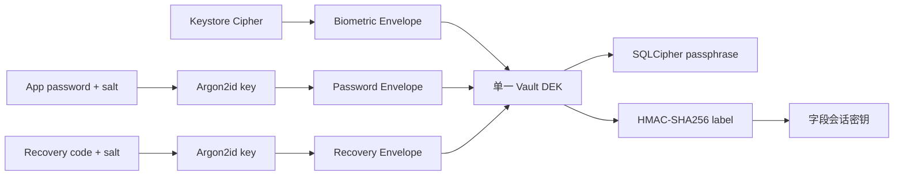

# 密钥管理

## 当前密钥体系

当前实现不是双 DEK。一个随机 256-bit Vault DEK 被多个认证 Envelope 包装；字段会话密钥使用固定域分离标签从
DEK 派生。该决策由 [ADR-0019](../decisions/ADR-0019-single-dek-derived-session-key.md) 替代旧
ADR-0003。

## VaultBootstrapStore

Envelope 与 verification tag 必须在数据库打开前可用，因此保存于独立 VaultBootstrapStore。接口位于
Domain 的 `access.port`，生物识别轮换状态位于 `access.model`；当前 Proto DataStore 实现位于 Data 层。
Room schema 当前没有认证 Envelope 真相源；不得重新把认证材料写入业务数据库。

## 生命周期

1. 初始化生成 DEK、verification tag 和首个 Envelope。
2. 解锁时读取指定 Envelope，解封并验证 DEK。
3. `DekManager` 保存 DEK 的内存副本并派生会话密钥。
4. 添加认证方式只新增或替换 Envelope。
5. 锁定由 `VaultSessionController` 协调数据库封存，再由 `DekManager` 覆盖内存 DEK 与字段密钥。

当前应用没有删除完整 Vault 的操作。设置中的“永久重置”只删除 SQLCipher 数据库及托管附件/图片，随后用现有
Bootstrap DEK 打开空数据库；认证 Envelope、verification tag、生物识别绑定和 Autofill Inbox 的密钥材料及队列
均保留。该操作不等同于删除 Vault，也不清除 Inbox。完整行为见[数据库重置](../data/database.md#初始化失败与数据重置)
和[Sealed Inbox 生命周期](../features/autofill/sealed-inbox.md#备份和生命周期)。

`SecretKeySpec.encoded` 可能返回副本，对它调用 `fill(0)` 不能证明内部密钥已被擦除。文档和注释只能表述为“尽力缩短并覆盖可控副本”。

## 参数与清理的已知边界

首次请求认证 KDF 参数时，`DeviceKdfConfiguration.selected()` 在 `Dispatchers.Default` 测量 Argon2id v1.3 基线：memory 为 65,536 KiB（64 MiB）、iterations 为 3、parallelism 为 4、输出为 256 bit。`DeviceKdfPolicy.select(heapMiB, processors, baselineMillis)` 只生成以下两类配置：当最大堆至少 384 MiB、处理器数至少 4 且基线不超过 150 ms 时，选择 131,072 KiB / 3 次；否则选择 65,536 KiB，并在基线不超过 250 ms 时用 4 次迭代，较慢时用 3 次。版本、内存、迭代、并行度和输出长度由 `initializeIfAbsent(candidate)` 写入 `bootstrap.pb`，并以 DataStore 的 first-writer-wins 结果为准。之后主密码及恢复码创建和验证只读取该配置，不在解锁时重新校准；加密备份仍使用其独立的 v1 头部参数。

配置读取的调用闭包是 `DeviceKdfConfiguration.current()` → `selected()`。`selected()` 在实例 Mutex 内先调用
`AuthenticationKdfConfigurationStore.load()`；命中时原样返回已校验的 Domain 参数，缺失时要求
`VaultBootstrapStore.loadAll().isEmpty()`，再以 `Dispatchers.Default` 执行 `calibrate()`，最后调用
`store.initializeIfAbsent(candidate)`。校准用固定非用户口令、随机 salt 和
`KeyDerivation.BASELINE_ARGON2ID_PARAMETERS` 调用
`KeyDerivation.deriveKeyBytesArgon2id(password, salt, parameters)`，测量完成后先擦除返回的 hash，并在 `finally`
覆盖 calibration `CharArray` 与 salt。`DeviceKdfPolicy.select(heapMiB, processors, baselineMillis)` 仅根据最大堆、
CPU 数和基线耗时产生候选参数；DataStore 的 first-writer-wins 更新结果才是最终持久配置。

写入路径由 `ProtoVaultBootstrapStore.initializeIfAbsent(parameters)` 在 `DataStore.updateData` 内再次检查已有
field 10 与 envelope 数量；若已有 envelope 却缺少 KDF 元数据则拒绝初始化。映射到 Proto 的字段是 version、
memory KiB、iterations、parallelism 和 key length；读取时映射回 `AuthenticationKdfParameters`，构造时再次验证
值域：版本固定为 Argon2 1.3 (`0x13`)，memory 为 65,536–131,072 KiB，iterations 为 3–5，parallelism 固定为 4，输出固定为 256 bit。当前设备选择器实际只写 3 或 4 次；Domain 验证器允许读到 5 次。两者差异尚未裁定，不能据此推断存在有效的 5 次配置来源；后续须明确 5 是预留/已发布值还是过宽范围，见安全 TODO Task 9。`bootstrap.proto` 字段 10 只描述认证信封 KDF，不修改 Room schema 或独立备份头。

应用密码创建与 `DefaultRecoveryCodeDraftFactory.generate()` 都先取 `kdfConfiguration.current()`，再把相同参数对象传入
`KdfRunner.execute(secret) { chars -> KeyDerivation.deriveKeyBytesArgon2id(chars, salt, parameters) }`；
`DefaultAuthenticationMethodProvisioner.checkRecoveryCode()` 与 `CredentialMethodExecutor` 的认证解封路径也从同一
配置读取参数，并将信封中原有 salt 和选定参数一起传给 Argon2id。加密备份的 codec 继续依据备份自描述头构造
`Argon2idParameters`，不读取认证配置。

参数及随机 salt 是公开元数据，不依赖隐藏来保证安全。读取时先按允许范围校验，再运行 KDF；配置缺失且已有认证信封时明确拒绝，不自动推断旧默认值或删除 Vault。用户已明确只考虑全新安装；旧开发数据须由用户显式清除或重新安装。

当前参数存于与认证信封相同的 `bootstrap.pb`，尚未把参数纳入每个信封的 AEAD 认证上下文。进一步完整性增强和恢复测试见[安全跟踪 Task 9](../superpowers/plans/2026-11-06-passly-security-scan-followups.md#task-9设备校准-argon2id同时固定每个信封的派生上下文)。

2026-11-06 源码复核发现 `DekManager.lock()` 先将持有数组的 `Unlocked` 替换为 `Locking`，再调用只处理 `Unlocked` 的擦除函数，
导致原缓存 DEK 未被显式覆盖。上文生命周期中的擦除是应满足的合同，当前实现尚有这一缺口；状态变为 Locked 不能作为缓冲已归零的证据。
整改与行为测试见[安全跟踪 Task 8](../superpowers/plans/2026-11-06-passly-security-scan-followups.md#task-8在状态替换前覆盖原缓存-dek)。

## 代码位置

| 职责 | 类/函数 | 源码文件 |
| --- | --- | --- |
| 定义 bootstrap 数据边界 | `VaultBootstrapStore`、`ProtoVaultBootstrapStore` | [`VaultBootstrapStore.kt`](../../domain/src/main/kotlin/com/aozijx/passly/domain/access/port/VaultBootstrapStore.kt)、[`ProtoVaultBootstrapStore.kt`](../../data/src/main/java/com/aozijx/passly/data/local/datastore/ProtoVaultBootstrapStore.kt) |
| 定义并持久化认证 KDF 参数 | `AuthenticationKdfParameters`、`AuthenticationKdfConfigurationStore.load()`、`initializeIfAbsent(parameters)`、`ProtoVaultBootstrapStore.toProto()` / `toDomain()` | [`AuthenticationKdfParameters.kt`](../../domain/src/main/kotlin/com/aozijx/passly/domain/access/model/AuthenticationKdfParameters.kt)、[`AuthenticationKdfConfigurationStore.kt`](../../domain/src/main/kotlin/com/aozijx/passly/domain/access/port/AuthenticationKdfConfigurationStore.kt)、[`ProtoVaultBootstrapStore.kt`](../../data/src/main/java/com/aozijx/passly/data/local/datastore/ProtoVaultBootstrapStore.kt)、[`bootstrap.proto`](../../data/src/main/proto/bootstrap.proto) |
| 校准设备、选择并读取已持久化参数 | `DeviceKdfConfiguration.current()`、`selected()`、`calibrate()`、`DeviceKdfPolicy.select(heapMiB, processors, baselineMillis)` | [`DeviceKdfConfiguration.kt`](../../security/src/main/java/com/aozijx/passly/security/authentication/DeviceKdfConfiguration.kt) |
| 创建与验证应用密码/恢复码时将参数传入 KDF | `DefaultAuthenticationMethodProvisioner.setAppPassword()` / `checkRecoveryCode()`、`DefaultRecoveryCodeDraftFactory.generate()`、`CredentialMethodExecutor.execute()` | [`DefaultAuthenticationMethodProvisioner.kt`](../../security/src/main/java/com/aozijx/passly/security/authentication/DefaultAuthenticationMethodProvisioner.kt)、[`DefaultRecoveryCodeDraftFactory.kt`](../../security/src/main/java/com/aozijx/passly/security/authentication/DefaultRecoveryCodeDraftFactory.kt)、[`CredentialMethodExecutor.kt`](../../security/src/main/java/com/aozijx/passly/security/authentication/CredentialMethodExecutor.kt) |
| 管理 DEK 与派生字段密钥 | `DekManager`、`SensitiveFieldEncryptor` | [`DekManager.kt`](../../core/src/main/kotlin/com/aozijx/passly/security/dek/DekManager.kt)、[`SensitiveFieldEncryptor.kt`](../../core/src/main/kotlin/com/aozijx/passly/security/dek/SensitiveFieldEncryptor.kt) |
| 封装并恢复 DEK envelope | `EnvelopeManager` | [`EnvelopeManager.kt`](../../core/src/main/kotlin/com/aozijx/passly/security/envelope/EnvelopeManager.kt) |
| 协调认证时的数据库会话开关 | `VaultSessionController` | [`VaultSessionController.kt`](../../security/src/main/java/com/aozijx/passly/security/authentication/VaultSessionController.kt) |
